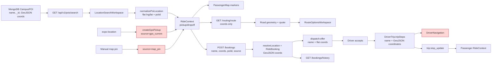

# CAMPUSRIDE MAP, LOCATION, ROUTING & RIDE-LIFECYCLE RELIABILITY AUDIT

Audit date: 2026-10-08  
Repository snapshot: branch `dev`, HEAD `97aa06f`  
Audit mode: read-only investigation; no application source, configuration, database records, branch state, or running processes were changed.

## 1. Executive summary

CampusRide is not ready for a production-like end-to-end ride demonstration in its current working-tree state. The active Passenger UI has a coherent MapLibre-based shell, defensive route-result handling, and useful pure tests. The backend has canonical `RideBooking`/`DriverTrip` models, authenticated Socket.IO rooms, atomic booking claims, stop ordering, and proximity enforcement. However, the frontend and backend are presently separated by several concrete contract mismatches.

The highest-impact findings are:

- **P0 — GPS and map-pin bookings fail backend schema validation.** The frontend sends location sources `gps_current` and `map_pin`, while `RideBooking` accepts only `poi`, `gps_pin`, or `reverse_geocoded`. A local schema-only validation reproduced both failures without touching MongoDB.
- **P0 — opening Driver Home can make a driver available without an explicit choice.** Driver navigation omits `isOnline` when creating `driverProfileData`; Driver Home defaults the missing value to `true` and immediately sends it with GPS updates.
- **P0 — the manual redispatch endpoint lacks booking ownership/role authorization.** Any authenticated user who knows a booking ID can trigger dispatch.
- **P1 — canonical POIs never render on the Passenger map.** They are loaded into state but the map is explicitly passed `pois={[]}`.
- **P1 — Driver navigation reads the wrong stop coordinate property.** The backend stores `tripStops[].coordinates`; the frontend reads `activeStop.location`, falls back to a fixed coordinate, and never calculates a road route.
- **P1 — the dispatch recovery path is split across canonical and legacy data models.** Passenger booking creates `RideBooking`, while Driver polling reads legacy `/rides/pending` (`Ride`). Canonical offers therefore depend on a transient socket event.
- **P1 — route/map camera padding is internally inconsistent.** `PassengerMap` passes `mapPadding`, but the MapLibre compatibility layer ignores it; initial route/approach fits use only 40 px bottom padding beneath sheets that are roughly 222–334 px tall.
- **P1 — no authoritative recovery exists for missed assignment or completion events.** Socket reconnect rejoins a trip only when the client already knows its trip ID; it does not query active booking/trip state after reconnect or app resume.

Positive findings:

- The active app path uses MapLibre/OpenFreeMap, not an active `react-native-maps` import.
- POI selection normalization preserves name, ID, category, campus zone, provenance, and `[longitude, latitude]` order in Passenger state.
- Explicit POI names remain intact through Passenger selection, markers, route review, and a POI-backed booking.
- The Passenger route layer rejects missing geometry, endpoint-only geometry, stale endpoint results, estimate-only fallbacks, and missing fares.
- Driver acceptance uses an atomic backend booking claim and stop execution enforces ownership, ordering, and proximity.
- Passenger history reads canonical `RideBooking` records and renders canonical dropoff names and fares.

Readiness verdict: **NOT READY**. The two location-source/availability P0 defects and Driver stop-coordinate P1 defect must be resolved before a meaningful physical-device lifecycle test. Successful rendering or export would not prove ride correctness.

## 2. Scope, repository state, and recent change context

The current working tree is materially ahead of HEAD and is the only valid audit target. It contains extensive modified and untracked Passenger, Driver, MapLibre, routing, socket, safety, and test work. No attempt was made to reset, clean, stage, commit, or reinterpret the repository from older architecture notes.

Relevant recent committed baseline:

- `97aa06f` — frontend architectural baseline/technical debt documentation.
- `8d9300f` — role-based routing architecture.
- `af277c0` — `RideContext` state machine and authenticated socket manager.
- `a0f5a4a` — modular API layer and request interceptors.

Major current uncommitted/untracked areas affecting this audit include:

- `frontend/src/components/maps/`
- `frontend/src/components/passenger/`
- `frontend/src/utils/`
- `frontend/test/`
- `frontend/src/screens/driver/DriverHome.js`
- `frontend/src/screens/driver/DriverNavigation.js`
- `frontend/src/context/RideContext.js`
- `backend/src/services/routingService.js`
- `backend/src/services/socketService.js`
- `backend/test/routing_service_provider.test.js`

The repository has no unified functional test command: `backend/package.json` defines `npm test` as an intentional failure placeholder, and the frontend has no test script. Tests must be invoked directly with Node.

## 3. Current architecture

### 3.1 Frontend

- Expo SDK 54, React Native 0.81.5, React 19.1.
- Entry point: `frontend/index.js:1-16`. `EXPO_PUBLIC_MAPLIBRE_SPIKE=true` selects an isolated spike; current `.env` is `false`, so the full app is active.
- Provider composition: `frontend/App.js:103-115` wraps auth, theme, ride, and safety contexts around the role router.
- Role routing: `frontend/src/navigation/RootNavigator.js:53-73` selects Auth, Driver, or Passenger navigation.
- Passenger shell: `PassengerHome` mounts one persistent `PassengerRideShell` (`frontend/src/screens/passenger/PassengerHome.js:5-13`). Locations live in `RideContext`; workspace, route, GPS, and camera state live locally in the shell.
- Driver flow: Driver Home, Active Requests, Driver Navigation, and Trip Summary are separate screens coordinated through navigation parameters (`frontend/src/navigation/DriverNavigator.js:139-208`).
- HTTP origin: `EXPO_PUBLIC_API_URL`, normalized once by `frontend/src/api/axios.js:5-18`. Socket.IO derives the same origin in `frontend/src/api/socketHelper.js:21-33`.

### 3.2 Backend

- Express 5, Mongoose 9, Socket.IO 4.
- `backend/server.js:58-75` mounts legacy Ride routes plus canonical POI, Booking, Trip, Rating, Routing, and Safety routes.
- Startup waits for MongoDB, then idempotently upserts canonical POIs (`backend/server.js:85-101`; `backend/src/services/poiService.js:189-210`).
- Canonical ride domain:
  - `RideBooking`: passenger request, endpoint identity, fare, assignment, completion/history.
  - `DriverTrip`: physical vehicle trip and ordered stops.
  - Dispatch service: eligible-driver selection and socket offers.
  - Trip service: atomic accept/pooling and proximity-gated stop transitions.
- A separate legacy `Ride` domain is still mounted and is still consumed by Driver polling.

### 3.3 Map, GPS, search, and routing

- Map adapter: `frontend/src/components/maps/MapLibreCompat.js` wraps `@maplibre/maplibre-react-native` and uses OpenFreeMap Liberty at `https://tiles.openfreemap.org/styles/liberty` (`:19`, `:225-251`).
- Location: `expo-location`; Passenger uses cached/current one-shot requests; Driver uses continuous foreground subscriptions.
- POIs: MongoDB `campus_pois`, seeded from `CANONICAL_CAMPUS_POIS`.
- Search: unauthenticated `/api/v1/pois/search`, regex matching name/aliases, alphabetic sort.
- Routing: authenticated `/api/v1/routing/route`; ORS if configured, public OSRM demo otherwise, geodesic estimate as the final explicitly marked fallback.
- Pricing: calculated server-side from route distance/duration for both preview and booking.

## 4. End-to-end location data-flow diagram



Contract breaks shown in red:

1. `gps_current`/`map_pin` are rejected by the backend source enum.
2. `DriverNavigation` expects `activeStop.location`, but `DriverTrip` provides `activeStop.coordinates`.

### 4.1 Identity survival table

| Stage | Name | Coordinates | POI ID | Finding |
|---|---|---|---|---|
| Search API | Yes | GeoJSON `[lng, lat]` | `_id` | Correct |
| Frontend normalization | Yes | Flat `[lng, lat]` | `poiId` | Correct; validates global bounds |
| Passenger marker/summary | Yes | Flat `[lng, lat]` | In state | Correct for selected endpoint |
| Route request | Not sent | Query `lng,lat` | Not sent | Geometry is coordinate-based; identity remains in client state |
| Booking payload | Yes | Flat `[lng, lat]` | Yes | Correct for POIs; GPS/map-pin `source` is incompatible |
| `RideBooking` | Yes | GeoJSON `[lng, lat]` | Yes | Correct for accepted sources |
| Driver offer | Yes | Flat `[lng, lat]` | Dropped | Name/coordinates survive; identity metadata does not |
| `DriverTrip` stop | Yes | GeoJSON `[lng, lat]` | Dropped | Backend record is correct; Driver frontend reads wrong property |
| Passenger active trip | Original context name/coords | Original context coords | In context | Survives only while current JS state remains alive |
| Passenger history | Yes | GeoJSON | Yes | Canonical booking is returned |
| Driver history | Not mapped correctly | Buried in stops | No | UI falls back to generic endpoint labels |

## 5. GPS and current-location findings

### What works

- Passenger requests foreground permission and checks whether device services are enabled (`PassengerRideShell.js:402-436`).
- Cached positions are constrained to two minutes and 100 m accuracy (`locationSelection.js:1-35`; shell `:438-447`).
- Current position requests high accuracy and rejects inaccurate/invalid fixes (`PassengerRideShell.js:449-471`).
- Permission denial and GPS failure clear a GPS-derived pickup but preserve a manual pickup (`PassengerRideShell.js:394-400`, `:413-426`, `:472-490`).
- Camera fallback to the UG center does not populate authoritative pickup state.
- Manual selection mode prevents a later GPS result from overwriting a manual pickup (`locationSelection.js:57-61`; shell `:371-380`).
- Longitude/latitude order is correct in `createGpsPickup` (`locationSelection.js:47-55`).

### Confirmed limitations and defects

- **GPS is one-shot, not subscribed, for Passenger.** The fix is taken at shell mount or explicit retry and can become stale before booking. There is no timestamp/accuracy revalidation in `buildBookingPayload` or on the backend. Evidence: shell initialization `:170-191`, request `:402-494`, payload helper `routeSelection.js:42-60`.
- **The UI cannot clearly distinguish provisional, accurate, stale, unavailable, and manual states.** `locationStatus` has those internal states but is not passed to the idle workspace. `IdleDiscoveryWorkspace` declares `pickupLocationName`, `isLocating`, `locationError`, and `onPressPickup` (`:21-29`) but does not render/use them anywhere in its body (`:115-307`).
- **Current GPS pickup has only the generic name `Current location`.** This is truthful, but no reverse-geocoded/campus label is attached (`locationSelection.js:47-55`).
- **The current-position request has no application-level timeout.** A usable cached fix may remain provisional while `getCurrentPositionAsync` waits (`PassengerRideShell.js:438-469`).
- **Driver GPS does not classify age or accuracy.** Driver Home and Driver Navigation accept every high-accuracy callback without checking `accuracy` or timestamp (`DriverHome.js:363-437`; `DriverNavigation.js:252-292`).
- **Driver permission denial is only logged.** Driver Home can still display an online state and a fixed default map position (`DriverHome.js:43-48`, `:367-373`).

Conclusion: code can classify Passenger fresh/inaccurate/stale fixes at acquisition time, but the product does not expose those distinctions and does not preserve freshness through booking time.

## 6. Campus POI identity findings

### 6.1 Data model and live data

`CampusPOI` requires a unique name, category, GeoJSON point, campus zone, and provenance and indexes name/aliases plus coordinates (`backend/src/models/CampusPOI.js:3-90`). All 15 current seeds are explicitly `development_estimate`, not surveyed coordinates (`backend/src/services/poiService.js:3-186`).

The configured public HTTPS backend was checked with read-only GETs. `/api/health` returned `success:true`; `/api/v1/pois?limit=50` returned 15 POIs.

| Requested example | Actual live result | Identity assessment |
|---|---|---|
| Balme Library | `Balme Library` | Exact |
| University of Ghana Business School | No result | Missing exact/alias phrase |
| Great Hall | `Great Hall` | Exact |
| Legon Hall | `Legon Hall` | Exact |
| Mensah Sarbah Hall | `Mensah Sarbah Hall` | Exact |
| Evandy | `Evandy Hostel` | Alias resolves |
| Night Market | `Legon Night Market` | Alias resolves |
| Okponglo | `University Main Gate` | Alias resolves through `Okponglo Gate` |

The repository represents Business School as `UGBS Graduate Building` with aliases `Business School`, `UGBS`, `UGBS Grad`, and `Graduate School` (`poiService.js:91-102`). It does not include the full phrase “University of Ghana Business School.” “School of Engineering” is not in the seed, although it is presented as the search placeholder (`LocationSearchWorkspace.js:189-199`) and appears in a test fixture.

### 6.2 Identity preservation

- POI normalization correctly keeps `name`, `poiId`, `category`, `campusZone`, provenance, and exact coordinates (`locationSelection.js:63-79`).
- Passenger selection and summary use the normalized name without nearest-place substitution (`PassengerRideShell.js:679-732`; `LocationConfirmationWorkspace.js:36-75`; `RouteOptionsWorkspace.js:109-131`).
- `resolveLocation` preserves the supplied structured name/coordinates/poiId but strips category, campus zone, provenance, accuracy, timestamp, and verification (`backend/src/services/poiService.js:267-278`).
- Dispatch and trip stops preserve names and coordinates but intentionally/implicitly drop POI ID and other identity metadata (`dispatchService.js:88-103`; `tripService.js:66-87`).
- Map pins deliberately remain named `Selected location`; nearest-POI data is fetched but discarded from the display name (`frontend/src/api/services/poiService.js:46-83`). This avoids falsely claiming exact POI selection, but it provides weak confirmation and loses useful “near X” context.

No duplicate canonical names were found in the seed, and the database schema enforces unique names. Duplicate coordinates/near-duplicates were not proven.

## 7. Search and selection findings

### What works

- Search waits 200 ms before a request (`LocationSearchWorkspace.js:117-127`).
- A monotonically increasing request ID prevents an older in-flight request from overwriting a newer request after the newer fetch has started (`:88-114`).
- Server search includes names and aliases and limits results (`backend/src/services/poiService.js:216-235`).
- Selecting a result validates/normalizes coordinates, dismisses the keyboard, updates the correct field, and persists a local recent (`LocationSearchWorkspace.js:129-135`; shell `:700-732`).
- Changing an endpoint invalidates the prior route; route responses are additionally keyed to both current endpoints (`PassengerRideShell.js:356-365`, `:521-590`).
- Back from Ride Options returns to confirmation with locations intact (`PassengerRideShell.js:1064-1080`).
- Manual-pin reverse lookup has request IDs and workspace checks, preventing late responses after leaving pin mode (`:759-785`).

### Confirmed defects

- **Search failure is silent.** `errorMessage` is created and cleared but never assigned on failure and never rendered. Network failure falls back to a name-only local filter (`LocationSearchWorkspace.js:40`, `:99-111`, `:246-305`). An empty list is indistinguishable from “no match.”
- **Local fallback does not search aliases, category, or campus zone.** A network failure makes aliases such as “Okponglo” stop working even though the already-loaded POI contains the alias (`:99-110`).
- **There is a debounce-window race.** The request ID increments when `fetchPOIs` begins, not when input changes. An old response can temporarily populate results after a newer query is typed but before its 200 ms timer fires. Clearing does not increment the ID until `fetchPOIs('')`, which is not called by the clear branch (`:78-89`, `:117-127`).
- **Pickup highlighting is wrong.** Result selection always compares against `dropoffLocation?.name`, even in pickup mode (`:261-270`). It also compares names rather than stable POI IDs.
- **No result/empty/retry state exists.** The `FlatList` has no `ListEmptyComponent`; initial POI load errors only reach the console (`:53-76`, `:246-305`).
- **Search ranking is alphabetic, not relevance-based.** The backend applies regex filtering then `.sort({name:1})` (`poiService.js:225-235`).

Selection state remains correct during the ordinary mounted Passenger flow. It is not persisted across a JS process restart, and local `workspaceMode` cannot reconstruct every `RideContext` state after a remount.

## 8. Map rendering, markers, camera, and bottom sheets

### 8.1 Map implementation

All active Passenger and Driver map imports resolve through `MapLibreCompat`; no active source import of `react-native-maps` or `react-native-maps-directions` was found. The legacy packages remain installed but are not imported by current `frontend/src` code.

The adapter provides markers, a GeoJSON LineString layer, camera movement, fit bounds, region callbacks, OpenFreeMap tiles, and a map-failure overlay (`MapLibreCompat.js:78-139`, `:141-258`). Attribution is enabled (`:232`).

### 8.2 Confirmed Passenger issues

- **POI markers are disabled at the call site.** `campusPois` is loaded (`PassengerRideShell.js:496-518`) but `PassengerMap` receives `pois={[]}` (`:1010-1038`).
- **`mapPadding` is ignored.** PassengerMap supplies it at `PassengerMap.js:152-164`, but the adapter's prop list has no `mapPadding` (`MapLibreCompat.js:141-155`).
- **Several compatibility props are no-ops.** `customMapStyle` and `showsPointsOfInterest` are passed (`PassengerMap.js:160-161`) but not accepted by the adapter. The long Google-style JSON in `PassengerMap.js:17-94` therefore does nothing.
- **Initial fit padding hides content under sheets.** Route fit uses bottom 40 (`PassengerRideShell.js:569-574`) while Route Options reserves roughly `318 + safeBottom` (`:153-168`). Driver approach and active-trip first fits also use bottom 40 (`:218-278`). Recenter uses the larger dynamic value, so the first view and recentered view are inconsistent.
- **Idle sheet geometry is not shared with the camera.** Idle sheet can be 70/195/390 px (`IdleDiscoveryWorkspace.js:15-18`), while the parent always assumes 236 px (`PassengerRideShell.js:156-168`). The child never reports panel state upward.
- **The map has no loading state or tile retry control.** Only `onDidFailLoadingMap` produces an overlay (`MapLibreCompat.js:242-256`).

The recent blank-gap correction is architecturally sound in one respect: `PassengerMap` and the native map fill the full parent (`PassengerMap.js:303-307`; `MapLibreCompat.js:225-231`) and sheets overlay it. The defect is camera/padding synchronization, not the full-screen map layout itself.

The idle and Driver Home pan responders are attached to the drag-handle area rather than the entire sheet (`IdleDiscoveryWorkspace.js:127-138`; `DriverHome.js:674-690`), so no repository evidence proves that all map gestures are intercepted. Physical-device gesture testing remains required.

### 8.3 Driver map issues

- Driver Home map updates its marker from a continuous foreground location subscription.
- Socket offers displayed on Driver Home do not copy `pickup.coordinates` into `pickupCoordinates`; its marker parser only reads `pickupCoordinates`/generic coordinates (`DriverHome.js:238-255`, `:473-500`). A canonical socket offer therefore has no request marker.
- Driver Navigation remounts the map whenever the target coordinate changes via a `key` (`DriverNavigation.js:451-466`). With the current coordinate contract bug it remains keyed to the fallback; after correction, each stop transition will still destroy/recreate native map state.
- Driver Navigation does not calculate any route; see Section 9.

## 9. Routing and road geometry

### What works

- Frontend and backend consistently use `[longitude, latitude]` in requests (`routingService.js:10-16`; `routingController.js:20-48`).
- Backend validates global coordinate bounds.
- ORS parsing and OSRM parsing require a LineString plus finite positive distance/duration (`backend/src/services/routingService.js:98-145`).
- Final geodesic fallback has no fake geometry and is explicitly `estimateOnly:true` (`:148-165`).
- Passenger normalization requires at least three valid route points plus positive distance/duration (`frontend/src/utils/routeSelection.js:17-35`).
- Passenger rejects estimate-only responses and missing quotes (`PassengerRideShell.js:550-561`), aborts old requests, and rejects stale endpoint responses (`:528-590`).
- In-memory route cache is bounded and expires (`backend/src/services/routingService.js:59-78`).

### Limitations and defects

- No `ORS_API_KEY`, custom ORS base, custom OSRM base, or custom timeout is configured in the current backend environment. Runtime therefore depends on the public OSRM demo (`routingService.js:175-205`). This is a demonstration dependency, not production routing infrastructure.
- The final geodesic fallback lets the route API return a quote that Passenger refuses. This is safe against fake road display but makes routing unavailable when both providers fail.
- Booking recomputes the route instead of binding to the preview quote/geometry (`bookingService.js:73-105`). If the preview used OSRM but the second request falls back to geodesic, booking can be created with a different distance/fare even though the frontend required a road route. `RideBooking` does not persist route source, distance, duration, or geometry, so the submitted journey cannot be audited against the displayed quote.
- Driver Navigation never calls the routing endpoint and `setRouteCoordinates` is never called. `routeCoordinates` is initialized empty and only read for fitting/rendering (`DriverNavigation.js:153`, `:333-340`, `:467-469`). Its “In-app navigation active” message is therefore false (`:563-568`).
- Shared-trip insertion uses geodesic distance times a fixed 1.3 tortuosity factor rather than provider road geometry (`routingService.js:283-320`). It is an optimization estimate, not road routing.

Authenticated live route behavior was not tested because no audit credential was used and no login/session mutation was authorized. Provider behavior was verified with isolated mock tests only.

## 10. Ride options, fares, and booking

### What works

- Route Options shows the current pickup/dropoff names and backend quotes (`RouteOptionsWorkspace.js:98-139`).
- Confirm is disabled without a matching route, 3+ geometry points, and both mode quotes (`PassengerRideShell.js:975-990`; `RouteOptionsWorkspace.js:141-161`).
- `buildBookingPayload` refuses stale endpoints or a missing selected-mode quote and clones exact endpoint names, IDs, and coordinates (`routeSelection.js:38-60`).
- Backend independently calculates fare; it does not trust a frontend fare amount (`bookingService.js:76-105`).
- After creation, the Passenger matching display prefers the authoritative booking fare (`PassengerRideShell.js:992-999`).

### Confirmed defects and mismatches

- **P0 source mismatch:** GPS source is `gps_current` (`locationSelection.js:1`, `:47-55`) and map-pin source is `map_pin` (`PassengerRideShell.js:787-805`), but the schema enum is only `poi`, `gps_pin`, `reverse_geocoded` (`RideBooking.js:35-39`). POI booking is valid; GPS and map-pin booking are not.
- Frontend accuracy, timestamp, verified flag, category, campus zone, and provenance are silently dropped by `resolveLocation` and are not represented in `RideBooking` (`poiService.js:267-278`; `RideBooking.js:3-42`). The backend cannot enforce GPS freshness/accuracy.
- Route preview and booking fare are two independent provider calls. No quote ID/hash/version is submitted. The post-booking UI reconciles the amount, but the user is not explicitly asked to accept a changed fare.
- Shared Ride always displays `1–3` seats (`RouteOptionsWorkspace.js:86-96`) although driver-selected shared capacity can range with vehicle configuration and the backend model permits up to 20 (`User.js:39`, `:214-230`).
- `routeEstimateOnly` is passed and declared but never displayed (`PassengerRideShell.js:1180-1196`; `RouteOptionsWorkspace.js:8-26`). Presently this is masked by the parent refusing estimate-only routes.

## 11. Dispatch and Driver acceptance

### Canonical path

1. `POST /bookings` creates `RideBooking` and asynchronously dispatches (`bookingRoutes.js:9-35`).
2. Eligible driver rules require approved, online, fresh heartbeat, valid coordinates, within radius, and no active trip (`dispatchService.js:10-62`).
3. Offer payload contains booking ID, ride mode/type, endpoint names/coordinates, fare, currency, and expiration (`:68-115`, `:256-327`).
4. Socket private room is `user:{driverId}`; socket authentication rechecks user suspension/blocking (`socketService.js:14-72`).
5. Acceptance atomically claims a pending booking and creates/updates a `DriverTrip` (`dispatchService.js:330-459`; `tripService.js:16-195`).
6. Passenger receives private `ride:assigned` and joins the trip room (`dispatchService.js:350-372`; `RideContext.js:93-119`).

### Confirmed defects

- **Driver availability defaults to online.** `DriverNavigator` creates profile data without `isOnline` (`DriverNavigator.js:34-47`); Driver Home then uses `driverData?.isOnline ?? true` (`DriverHome.js:31-48`) and sends `isOnlineRef.current` with the first GPS sync (`:363-419`). This can change backend eligibility merely by opening the screen.
- **Canonical/legacy queue split.** Driver Home and Active Requests poll `/rides/pending` (`DriverHome.js:330-361`; `ActiveRequests.js:28-65`), which reads legacy `Ride` (`rideRoutes.js:21`; `rideController.js:115-137`). Passenger Shell creates canonical `RideBooking`. A missed socket offer is not recovered by polling.
- **Duplicate dispatch:** booking creation already triggers dispatch asynchronously (`bookingRoutes.js:14-25`), then Passenger Shell immediately calls `POST /bookings/:id/dispatch` (`PassengerRideShell.js:875-895`). The backend does not record an offer instance or prevent repeated sends.
- **Redispatch authorization:** `POST /bookings/:id/dispatch` checks only authentication and performs no passenger ownership/admin/role validation (`bookingRoutes.js:37-64`).
- **Driver Home fare mapping ignores `estimatedFare`.** It maps only `fare?.estimatedAmount || fare`, so canonical socket offers display GH₵0 (`DriverHome.js:246-254`, `:639-645`). Active Requests handles `estimatedFare` correctly (`ActiveRequests.js:90-104`).
- **Decline is transient.** Backend acknowledges decline without persistence, candidate exclusion, or redispatch (`socketService.js:175-207`). The same driver can receive the same booking again.
- **Offer expiry is client-only.** Driver screens locally drop offers by `expiresAt`; backend emits no `dispatch:offer_expired`/`dispatch:offer_cancelled` in the canonical dispatch flow. Pending booking expires only after 15 minutes via cron (`cronService.js:7-31`).
- **Acceptance timeout race:** Driver screens wait three seconds for socket ack, then invoke REST. If socket acceptance commits just after the UI timeout, REST can fail as already claimed/active and the Driver UI reports failure despite a real assignment (`ActiveRequests.js:175-232`; `DriverHome.js:166-220`).

Driver Home's offer card is a separate high-z-index overlay above the bottom sheet (`DriverHome.js:605-672`, styles `:994-1009`), so it remains actionable when the sheet is collapsed. Expanded-sheet overlap and touch behavior still require Android verification.

## 12. Active trip and live tracking

### Backend correctness present

- Trip rooms enforce driver/passenger/admin membership (`socketService.js:77-106`).
- Driver telemetry validates bounds, speed, and trip ownership before trip-room relay (`:209-256`).
- Stop execution validates Driver ownership, terminal/idempotency state, pickup-before-dropoff ordering, and 75/100 m proximity (`tripService.js:627-741`).
- Passenger completion is emitted privately and Passenger leaves the room (`tripRoutes.js:151-173`; `RideContext.js:206-227`).

### Confirmed defects

- **Wrong Driver target coordinate:** backend stop schema is `coordinates` plus `name` (`DriverTrip.js:24-48`), while Driver Navigation resolves only `activeStop.location` (`DriverNavigation.js:163-183`). All authoritative trip stops therefore use fallback `{latitude:5.6037, longitude:-0.1870}` on the map.
- **No Driver route geometry:** `setRouteCoordinates` has no caller; the screen displays no road polyline and fits a straight two-point extent at best.
- **Missing passenger detail:** trip endpoints populate only `driverId`, not `tripStops.passengerId` (`tripRoutes.js:209-255`). Stops have no `passengerName`; Driver Navigation displays “Campus Passenger,” and phone is unavailable (`DriverNavigation.js:187-190`, `:491-540`).
- **Misleading summary:** wrapper constructs hardcoded `12 minutes` and `4.2 km` and reads flat `pickupLocation`/`dropoffLocation` that canonical `DriverTrip` does not have (`DriverNavigator.js:171-194`). `TripSummary` has additional fabricated defaults (`TripSummary.js:16-25`).
- **Possible duplicate completion navigation:** stop REST completion and the trip-room `trip:status_change=completed` both call `onTripCompleted` (`DriverNavigation.js:240-245`, `:383-401`). No once-guard exists.
- **Telemetry freshness is not represented to Passenger.** RideContext accepts any incoming timestamp, stores it, and renders the marker without age checking (`RideContext.js:121-131`; `PassengerMap.js:263-269`). A disconnected Driver marker can remain visually current.
- **No background/foreground recovery:** neither Passenger ride state nor Driver Navigation uses `AppState` to refresh authoritative trip status. Foreground subscriptions and socket state are assumed to resume correctly.

Passenger names/coordinates remain consistent in in-memory Passenger context, but no authoritative recovery fetch restores them after missed assignment, app restart, or remount.

## 13. Ride history findings

### Passenger

Passenger history uses canonical `/bookings/history`, filters terminal statuses, and renders `dropoff.name`, canonical status, time, ride mode, and completed fare (`RideHistoryScreen.js:48-87`; `ActivityRideCard.js:18-95`). The backend filters by current passenger/driver and populates counterpart records (`bookingRoutes.js:66-87`). This path is structurally correct.

### Driver

Driver history calls `/driver/earnings` (`Driver RideHistory.js:42-68`). That endpoint returns raw completed `DriverTrip` documents, fixes both earnings metrics at zero, and does not join bookings (`driverController.js:98-122`). The UI expects `ride.pickup`/`ride.dropoff` or legacy flat fields (`Driver RideHistory.js:175-176`), but canonical endpoint names are in `tripStops`. Result: generic “Campus Pickup/Destination,” no canonical fare, and zero earnings. This is a confirmed P1 functional mismatch.

## 14. Frontend state and interaction audit

### Strong areas

- Selected Passenger endpoints have one canonical owner in `RideContext` (`RideContext.js:33-36`).
- Route request ID, abort controller, and endpoint key substantially reduce stale-route races.
- Driver-assignment-versus-HTTP race is explicitly guarded (`RideContext.js:286-323`; shell `:875-888`).
- Manual pickup has an explicit mode ref, avoiding unwanted GPS overwrite.
- Android back handling prevents navigation during request/cancel mutations and preserves route configuration in ordinary flows (`PassengerRideShell.js:294-353`).

### Weak areas

- Passenger lifecycle is split between `RideContext.rideStep` and local `workspaceMode` (`PassengerRideShell.js:95-99`, `:200-216`). Only a subset of context states is mapped. A remount during `REVIEWING_OFFERS` or `MATCHING_DISPATCH` begins local mode at `IDLE`.
- GPS and POIs are duplicated between context-like endpoint state and shell-local acquisition state.
- Search error state is dead state; selected highlighting uses names rather than IDs.
- Idle bottom-sheet state is private to the child, preventing camera and control synchronization.
- Persistent socket is a module singleton and supports only three reconnection attempts (`socketHelper.js:21-33`). There is no explicit retry after attempts are exhausted.
- `RideContext` reacts to socket events but does not query current booking/trip state after reconnect (`RideContext.js:50-270`).
- Driver Home and Active Requests duplicate offer normalization and acceptance logic, and the two implementations already differ (`estimatedFare` and coordinates).

Assessment: coordinated localized refactoring is required around shared DTO normalization, dispatch acceptance, and lifecycle recovery. A wholesale screen rewrite is not justified. The Passenger shell architecture can be retained.

## 15. Failure and recovery audit

| Failure | Current behavior | Classification |
|---|---|---|
| Passenger permission denied | Clear error; no fake pickup; manual selection remains possible | Safe but idle feedback is not rendered |
| Passenger poor/stale fix | Rejected at acquisition | Safe initially; can become stale before booking |
| Driver permission denied | Console warning; UI may remain online/default-positioned | Unsafe/misleading |
| Internet/API loss during search | Silent local name-only fallback or blank list | Incomplete feedback |
| Map tiles fail | Full map error overlay | Clear, but no retry/loading state |
| Routing provider fails | Estimate-only response rejected; retry shown | Safe against fake route; service unavailable |
| Booking fails | Alert; route/selection retained | Recoverable, but source mismatch affects two core pickup modes |
| No eligible Driver | Immediate `NO_DRIVER` only when dispatch returns count 0 | Partial; pool-join result and later offer expiry are not covered |
| Driver declines | Offer disappears locally | Passenger not informed; decline not persisted |
| Socket drops | Status banner in active Passenger trip; limited reconnect | No authoritative missed-event recovery |
| App backgrounds/resumes | No explicit state reconciliation | Unverified/unsafe for missed lifecycle events |
| User changes destination rapidly | Route abort/key guards are good; search has a short stale-response window | Mixed |
| Request timeout | Axios 15 s; routing provider 7 s default | Errors surface, but matching can remain indefinitely |
| Malformed route | Rejected by frontend normalizer | Safe |
| Malformed socket telemetry | Backend ignores invalid bounds/speed | Safe at server boundary |
| Backend marks booking timed out | Cron updates DB only | Passenger matching UI receives no event |

## 16. Test and integration evidence

### 16.1 Pure frontend selection/routing tests

Command:

```powershell
node --test frontend/test/locationSelection.test.js frontend/test/routeSelection.test.js
```

Result: **16 passed, 0 failed, 0 skipped**.

Proves:

- cached GPS age/accuracy classification;
- GPS `[lng,lat]` creation;
- manual pickup protection;
- malformed POI rejection;
- route key coordinate order;
- rejection of missing/endpoint-only route geometry;
- stale route detection;
- booking payload identity preservation for a valid matching route.

Does not prove:

- rendered UI, map markers, native GPS behavior, API connectivity, backend schema acceptance, or physical-device behavior.

### 16.2 Routing-provider unit tests

Command:

```powershell
node --test backend/test/routing_service_provider.test.js
```

Result: **3 passed, 0 failed, 0 skipped**.

Proves with mocked fetch:

- ORS preference and cache behavior;
- OSRM road geometry fallback;
- final fallback is marked estimate-only.

Does not prove:

- actual ORS/OSRM availability, authenticated endpoint behavior, Ghana road coverage, or physical rendering.

### 16.3 Schema contract diagnostic

Command: an in-memory `RideBooking.validateSync()` diagnostic instantiated documents for each source; it did not connect to MongoDB.

Result:

- `poi`: valid
- `gps_current`: invalid enum
- `map_pin`: invalid enum
- `gps_pin`: valid
- `reverse_geocoded`: valid

This directly proves the current frontend/backend source mismatch. It does not prove HTTP error formatting.

### 16.4 Backend syntax checks

Command: `node --check` on POI, routing, booking, dispatch, trip, socket, booking-route, and trip-route modules.

Result: **8 parsed, 0 failed**.

This proves syntax only, not runtime behavior.

### 16.5 Read-only live backend checks

Commands: HTTPS GETs to the configured tunnel for `/api/health`, `/api/v1/pois?limit=50`, and eight representative `/api/v1/pois/search` queries.

Result:

- Health: pass, `CampusRide V2 Backend Engine is Live`.
- POI list: 15 records.
- Representative search: 7 queries returned the intended canonical/alias record; “University of Ghana Business School” returned 0.

This proves the configured public origin reached the running backend and Mongo-backed POI reads at audit time. It does not prove authentication, booking, Socket.IO, routing, or tunnel persistence.

### 16.6 Suites intentionally not run

Database-backed phase suites were not run because they connect to configured MongoDB and perform writes/deletes. Examples include:

- `phase2_1.test.js` deleting all `DriverTrip` and `Rating` records in setup/cleanup (`:54-64`, `:117-123`).
- `phase2_3.test.js` containing broad `RideBooking.deleteMany({})` and `DriverTrip.deleteMany({})` (`:75-82`).
- phase 2.5, cancellation, and safety suites creating/deleting users, bookings, trips, ratings, and safety records.

Running them against the current configured database would violate the read-only audit and data-preservation requirement. No test database URI was assumed.

### 16.7 Verification-level summary

| Level | Status |
|---|---|
| Code inspection | Completed for active map/location/search/routing/booking/dispatch/trip/history paths |
| Automated pure tests | 19 passed total |
| Read-only integration | Health and POI reads/search verified |
| Authenticated integration | Not performed |
| Emulator | Not performed |
| Physical Android device | Not performed |

## 17. Confirmed defects and root-cause matrix

| ID | Sev. | Observable symptom / affected flow | Evidence and root cause | Recommended correction | Likely files / owner | Verification |
|---|---|---|---|---|---|---|
| CR-LOC-001 | P0 | GPS or manual-pin booking fails | `locationSelection.js:47-55`; shell `:787-805`; `RideBooking.js:35-39`. Source vocabularies differ; reproduced by schema validation. | Define one canonical source enum and normalize at API boundary; add contract test. | `locationSelection.js`, shell, `poiService.js`, `RideBooking.js`, booking tests — **Codex** | Schema + API booking tests for all source types; Android booking |
| CR-DISP-001 | P0 | Driver can become online merely by opening Home | `DriverNavigator.js:34-47`; `DriverHome.js:31-48`, `:363-419`. `isOnline` omitted, then defaults true and is persisted. | Hydrate authoritative availability; default unknown/offline; require explicit online action. | Driver navigator/home, auth/profile DTO — **Codex contract**, Antigravity status feedback | Backend state check + cold-launch Android test |
| CR-SEC-001 | P0 | Any authenticated user can redispatch another booking ID | `bookingRoutes.js:37-64` has auth but no ownership/role check. | Require owning passenger/admin and pending state; audit repeated dispatch policy. | booking routes/service/tests — **Codex** | Authorization tests |
| CR-MAP-001 | P1 | Campus POI names/markers never appear on Passenger map | Shell loads POIs but passes `pois={[]}` at `PassengerRideShell.js:1010-1038`. | Pass normalized POIs and define marker density/selection contract. | Shell/PassengerMap — **Antigravity**, Codex data contract | Component test + Android visual test |
| CR-TRIP-001 | P1 | Driver map targets a fixed wrong coordinate | `DriverTrip.js:24-48` uses `coordinates`; `DriverNavigation.js:163-183` reads `location`. | Normalize TripStop DTO or read canonical GeoJSON coordinates. | DriverNavigation/shared mapper — **Codex** | DTO unit test + real pickup/dropoff Android test |
| CR-TRIP-002 | P1 | Driver sees no road route although UI claims navigation is active | `DriverNavigation.js:153`, `:333-340`, `:467-469`; no `setRouteCoordinates` call. | Route driver-to-current-stop and refresh per stop; truthful fallback UI. | DriverNavigation, routing API/service — **Codex**, Antigravity presentation | Route mock/integration + Android polyline test |
| CR-DISP-002 | P1 | Missed socket offer cannot be recovered from request polling | Driver polls legacy `Ride`; Passenger creates `RideBooking`. `DriverHome.js:330-361`; `rideRoutes.js:21`; `bookingRoutes.js:9-35`. | Add authorized canonical pending-offer query or durable offer model; retire this flow's legacy queue dependency. | booking/dispatch routes and Driver services — **Codex** | Disconnect/reconnect integration test |
| CR-DISP-003 | P1 | Driver Home socket offer shows GH₵0 and no pickup marker | `DriverHome.js:238-255`, `:473-500`, `:639-645` omit `estimatedFare` and nested pickup coords. | Centralize `DispatchOffer` normalization shared with ActiveRequests. | Driver shared mapper/screens — **Codex contract**, Antigravity rendering | Mapper tests + Android offer test |
| CR-BOOK-001 | P1 | Same booking is dispatched twice immediately | Auto-dispatch `bookingRoutes.js:14-25`; manual dispatch shell `:883-895`. | Choose one dispatch owner; use idempotent offer round IDs. | booking route, shell, dispatch service — **Codex** | Socket event-count test |
| CR-MAP-002 | P1 | Markers/routes can sit behind sheets; camera changes after recenter | `PassengerMap.js:152-164`; adapter ignores padding; initial fits use bottom 40 in shell `:218-278`, `:569-574`. | Implement native camera padding or consistently calculate fit padding from actual sheet state. | MapLibreCompat, PassengerMap/shell — **Antigravity**, Codex adapter contract | Camera unit/instrumented tests + Android sheet states |
| CR-ROUTE-001 | P1 | Road routing availability depends on public demo OSRM | `routingService.js:28-38`, `:175-205`; current ORS/custom OSRM config unset. | Configure supported provider/self-hosted endpoint with monitoring; preserve explicit estimate-only behavior. | Environment/infrastructure + routing service — **Codex/backend** | Authenticated live route tests and outage test |
| CR-ROUTE-002 | P1 | Booked fare/distance can diverge from preview on provider change/failure | Preview and booking independently call routing; booking accepts estimate-only and stores no route metadata (`bookingService.js:73-116`). | Issue a short-lived server quote/route ID or validate endpoint+route version; persist route metrics/source. | routing/booking models/services — **Codex** | Provider-failure race integration test |
| CR-STATE-001 | P1 | Passenger can miss assignment/completion while offline/backgrounded | `RideContext.js:50-270` replays no authoritative state; reconnect joins only known trip ID. | Add active-booking/trip reconciliation on connect/resume and idempotent state reducer. | RideContext, booking/trip query APIs — **Codex** | reconnect/background integration + Android |
| CR-STATE-002 | P1 | Matching can remain forever after offers expire/backend timeout | shell `:875-930`; cron updates DB only `cronService.js:7-31`. | Emit/status-poll terminal booking state and provide timed recovery UI. | cron/booking/socket + matching workspace — **Codex** and **Antigravity** | timeout integration + Android |
| CR-TRIP-003 | P1 | Driver sees “Campus Passenger” and cannot call passenger | trip endpoints populate only driver; `tripRoutes.js:209-255`; UI `DriverNavigation.js:187-190`. | Return authorized stop passenger display/contact DTO without exposing co-rider data. | trip service/routes/DriverNavigation — **Codex** | Solo/shared privacy tests + Android |
| CR-TRIP-004 | P1 | Completion summary shows invented 12 min/4.2 km and generic endpoints | `DriverNavigator.js:171-194`; `TripSummary.js:16-25`. | Build summary from persisted trip/booking route metrics; show unavailable instead of fake values. | Driver wrapper/summary + backend DTO — **Codex data**, Antigravity presentation | Summary mapper test + Android |
| CR-HIST-001 | P1 | Driver history has generic route names and zero earnings | `driverController.js:98-122`; Driver `RideHistory.js:42-68`, `:175-176`. | Join authorized bookings/stop names and calculated fares into a canonical history DTO. | driver controller/history service/UI — **Codex** | History API + UI test |
| CR-GPS-001 | P1 | Passenger pickup may be stale by booking time | One-shot acquisition shell `:170-191`, `:402-494`; payload does not revalidate `locationTimestamp`. | Revalidate/refresh GPS before quote/booking and validate accuracy/timestamp server-side where applicable. | shell, location helper, booking service/model — **Codex**; Antigravity state feedback | Time-controlled tests + Android movement test |
| CR-SEARCH-001 | P2 | Search failure/zero matches looks like a blank result list | `LocationSearchWorkspace.js:40`, `:53-76`, `:99-111`, `:246-305`. | Render error/empty/retry; search aliases in local fallback. | Search workspace/service — **Antigravity**, Codex normalization | Component tests + offline Android |
| CR-SEARCH-002 | P2 | Old results can briefly appear after a new query | Request generation advances at fetch start, not text change (`:78-127`). | Increment generation on every input change/clear; cancel request. | Search workspace/service — **Codex** | fake-timer race tests |
| CR-SEARCH-003 | P2 | Pickup search highlights destination selection | `LocationSearchWorkspace.js:261-270` always compares dropoff name. | Compare active field's stable `poiId`/coordinate key. | Search workspace — **Antigravity** | component test |
| CR-POI-001 | P2 | Formal Business School query and displayed Engineering prompt have no result | seed `poiService.js:91-102`; placeholder `LocationSearchWorkspace.js:193`; live query evidence. | Validate canonical campus catalog/aliases and remove fabricated prompts. | POI seed/API — **Codex**; prompt — **Antigravity** | catalog test + owner GIS review |
| CR-POI-002 | P2 | Arbitrary map selection always says “Selected location” | POI service discards nearby POI name `frontend poiService.js:46-83`. | Preserve exact coordinates and display honest “Near X” context with distance/provenance. | POI resolve contract — **Codex**; display — **Antigravity** | resolver tests + Android pin test |
| CR-DISP-004 | P2 | Declined/expired offers can reappear; no server offer lifecycle | `socketService.js:200-203`; client-only expiry in `ActiveRequests.js:141-158`. | Persist offer rounds/responses/expiry or minimally track exclusion per dispatch round. | dispatch/socket — **Codex** | offer lifecycle tests |
| CR-TRIP-005 | P2 | Completion can navigate twice | REST and socket both invoke completion without a once guard (`DriverNavigation.js:240-245`, `:383-401`). | Make completion navigation idempotent. | DriverNavigation — **Codex** | duplicate-event test |
| CR-MAP-003 | P2 | Map load can be blank until a terminal failure overlay | `MapLibreCompat.js:242-256` has no loading/retry state. | Expose load/error/retry states. | Map adapter/screen — **Antigravity** | tile-failure Android test |
| CR-HIST-002 | P3 | Passenger history header says all terminal rides are “Completed Trips” | `RideHistoryScreen.js:209-217` counts cancellations too. | Use “Trips” or count completed only. | Passenger history — **Antigravity** | UI test |

## 18. Unverified risks

These are not classified as confirmed defects without runtime evidence:

- OpenFreeMap tile performance, attribution placement, and availability on the target Android network.
- MapLibre `texture` rendering behavior, marker clipping, safe areas, and gesture arbitration on the installed development build.
- Exact `Camera.fitBounds` behavior across MapLibre Android versions after native layout changes.
- Socket authentication and reconnection through the current Cloudflare tunnel on two physical devices.
- MongoDB transaction support in the deployed database. The code has standalone fallback paths, but no audit mutation was allowed.
- Physical GPS accuracy and heading quality on the specific Passenger and Driver devices.
- Tunnel URL survival after the current tunnel process or laptop restarts. A quick Cloudflare URL is normally process-scoped, but this audit did not alter or restart it.
- Whether React Navigation keeps Passenger Home mounted under every owner interaction. Ordinary tab behavior should preserve it; recovery after process death is not implemented.
- Shared-trip privacy under the current unpopulated Driver stop DTO. Backend tests exist but were not run against a safe isolated database.

## 19. Priority summary

### P0 — block implementation acceptance

1. CR-LOC-001 location source enum mismatch.
2. CR-DISP-001 implicit Driver online transition.
3. CR-SEC-001 redispatch authorization gap.

### P1 — block end-to-end ride readiness

- Passenger POIs not rendered.
- Driver stop coordinate contract broken.
- Driver road routing absent.
- Canonical offers not recoverable through polling.
- Socket offer normalization defects.
- Duplicate dispatch.
- Camera/sheet padding mismatch.
- Unmanaged public routing dependency and quote/rebooking mismatch.
- Missing reconnect/app-resume reconciliation.
- Matching timeout not delivered to Passenger.
- Missing Driver passenger identity, fabricated summary, broken Driver history.
- GPS freshness not enforced at booking time.

### P2 — required reliability and feedback

- Search error/empty/race/highlight issues.
- Catalog alias/prompt mismatch.
- Weak manual-pin place feedback.
- Offer decline/expiry lifecycle.
- Duplicate completion callback.
- Map loading/retry feedback.

### P3 — polish

- Passenger history aggregate wording.

## 20. Coordinated remediation plan — not executed

### Batch 0 — freeze contracts and close P0s

Dependencies: none. Must precede all physical ride tests.

**Codex**

- Define shared canonical `RideLocation.source` values and normalize old aliases at the boundary.
- Add server validation for GPS accuracy/timestamp without trusting arbitrary client flags.
- Preserve explicit POI identity while accepting GPS/map-pin bookings.
- Make Driver availability hydrate from the backend and default safely offline/unknown.
- Authorize redispatch by booking ownership/role/status.
- Add isolated contract/authorization tests that do not target development data.

Likely files: location helpers, Passenger shell, backend POI/booking service, `RideBooking`, booking routes, Driver navigator/home, auth/user DTO tests.

Completion: POI, GPS, and map-pin bookings validate; opening Driver Home does not alter availability; unauthorized redispatch is 403.

### Batch 1 — canonical DTOs for POI, offer, and TripStop

Dependencies: Batch 0 source vocabulary.

**Codex**

- Add pure normalizers/types for `RideLocation`, `DispatchOffer`, and `TripStop`.
- Use one offer normalizer in Driver Home and Active Requests.
- Make Driver Navigation consume canonical stop coordinates/name and authorized passenger contact.
- Add canonical pending offers/active-trip recovery endpoint or durable offer state.
- Keep legacy Ride endpoints operational only where still intentionally used.

**Antigravity**, after DTO freeze

- Render the selected POI and current pickup with stable selected feedback.
- Display honest missing-contact and unavailable-route states.

Completion: same POI name/coordinates observed in Passenger selection, offer, Driver target, active trip, and details.

### Batch 2 — route and quote integrity

Dependencies: canonical endpoint DTOs.

**Codex**

- Configure a supported routing provider or owned OSRM service.
- Persist/identify preview quote and route metrics; bind booking to endpoint+quote version.
- Calculate Driver-to-current-stop road routes and update after stop sequence changes.
- Persist summary/history distance, duration, source, and fare.

**Antigravity**

- Present route-source failure, retry, and changed-fare confirmation.
- Remove “navigation active” when no valid road route exists.

Completion: route geometry follows roads; displayed and booked endpoint/quote identity matches; outage never masquerades as road routing.

### Batch 3 — lifecycle recovery and idempotency

Dependencies: canonical booking/trip query contract.

**Codex**

- Reconcile active booking/trip on socket connect, reconnect, app foreground, and screen remount.
- Make offer rounds, acceptance callbacks, assignment, cancellation, stop changes, and completion idempotent.
- Deliver timeout/no-driver/cancellation status to both roles.
- Remove duplicate auto/manual dispatch ownership.

**Antigravity**

- Add clear reconnecting, stale Driver location, timeout, retry, and recovered-trip UI.

Completion: forced disconnect/background tests recover the same booking/trip without duplicate navigation or lost endpoints.

### Batch 4 — map/search/camera reliability

Dependencies: DTOs and routing state stable.

**Codex**

- Pass canonical POIs to the map and expose supported MapLibre camera/padding/error APIs.
- Fix search generation cancellation and local alias matching.
- Add truthful near-POI resolution contract.

**Antigravity**

- Tune marker density, selection feedback, map-pin confirmation, loading/error/retry UI.
- Report live sheet height to camera layout or use a shared sheet state.
- Validate every collapsed/compact/expanded map viewport without redesigning screens.

Completion: selected endpoints and route remain visible in every sheet state; slow/offline search cannot show stale or blank unexplained results.

### Batch 5 — regression and Android acceptance

Dependencies: Batches 0–4.

**Codex**

- Run pure/unit suites plus isolated Mongo integration suites against a dedicated disposable test database.
- Add end-to-end contract tests for location sources, offer recovery, stop DTOs, route quote binding, socket replay, and history.

**Antigravity + owner**

- Execute the physical Android checklist below on Passenger and Driver devices.

Completion: automated suites pass with explicit counts; owner signs off physical evidence.

## 21. Codex versus Antigravity ownership

### CODEX

- POI/location/offer/stop data contracts and normalization.
- Coordinate order/bounds/freshness validation.
- Booking source schema and payload integrity.
- Route provider, route/quote identity, and persisted metrics.
- Dispatch authorization, eligibility, durable offer state, acceptance races.
- Socket room events, reconnect reconciliation, lifecycle idempotency.
- Driver canonical history DTO.
- Automated functional and integration regression tests.

### ANTIGRAVITY

- Selected-place, GPS quality, loading, error, empty, retry, and recovery presentation.
- Marker selection, density, callouts, and route visibility.
- Camera/sheet visual tuning once supported adapter APIs exist.
- Passenger and Driver map interaction, safe areas, touch targets, and gestures.
- Honest visual states for unavailable route, stale telemetry, and recovered trip.
- No data-contract changes without Codex contract agreement.

### Shared sequencing rule

Codex must first freeze the DTO fields and lifecycle states. Antigravity may then bind visual states to those contracts. Neither side should independently invent fallback endpoint names, coordinates, fares, duration, or Driver/passenger identity.

## 22. Required and avoidable backend changes

### Required

- Canonicalize accepted location sources and preserve validation metadata.
- Protect redispatch ownership/role/status.
- Provide durable canonical offer/active-trip recovery, or an equivalent authoritative query.
- Return a normalized authorized TripStop/passenger DTO.
- Bind or persist route/quote metrics used for booking and summary/history.
- Emit or expose booking timeout/cancellation status for recovery.
- Configure a supported road-routing provider for demonstration reliability.

### Avoidable

- No new map tile backend is required; OpenFreeMap rendering is already integrated.
- No Google Maps API key or Google billing dependency is required.
- No screen redesign is required.
- No replacement of the `RideBooking`/`DriverTrip` architecture is required.
- No new database is required; isolated test database configuration is required for safe testing.
- No public reverse-geocoding service is strictly required; honest “Near canonical POI” context can be produced from existing POIs.
- No framework or Expo SDK upgrade is required.

## 23. Physical Android acceptance checklist

Use the existing development build unless a native dependency/configuration change is introduced.

### Map and GPS

- [ ] Full app launches with spike flag false and no legacy Google MapView crash.
- [ ] OpenFreeMap tiles load; attribution is visible and not covered.
- [ ] Passenger permission grant, denial, disabled services, poor accuracy, and retry each show a truthful state.
- [ ] Manual pickup is never overwritten by a later GPS fix.
- [ ] Passenger current pickup is refreshed/revalidated before booking.
- [ ] Driver starts in the backend's real availability state and never goes online implicitly.
- [ ] Driver permission denial cannot show a false ready/online state.

### POI identity and search

- [ ] Test all representative POIs and documented aliases.
- [ ] The exact selected canonical name appears in result, marker, confirmation, options, offer, Driver stop, active trip, and history.
- [ ] Pickup and destination are never swapped.
- [ ] Clear/change/back/reselect preserves only the intended endpoint.
- [ ] Slow responses cannot replace newer results.
- [ ] Offline/empty search has feedback and retry.
- [ ] Manual map pin shows honest coordinate/nearby-place confirmation.

### Camera and sheets

- [ ] Pickup, destination, Driver, and route remain visible with Passenger sheet collapsed, compact, and expanded.
- [ ] Driver offer remains actionable with Driver sheet collapsed/expanded.
- [ ] Recenter and initial fit produce the same usable viewport.
- [ ] Sheet drag does not steal ordinary map pan/zoom gestures.
- [ ] Rotation is not applicable because portrait is locked; verify safe areas and Android back behavior.

### Routing and booking

- [ ] Route visibly follows roads for several campus pairs.
- [ ] Route outage shows retry and never a fake straight road route.
- [ ] Distance/ETA/fare match selected endpoints.
- [ ] Solo and Shared preview quotes match authoritative booking or prompt on change.
- [ ] POI, GPS, and manual-pin bookings all succeed.

### Dispatch and lifecycle

- [ ] Eligible online Driver receives exactly one offer with correct name, coordinates, fare, and expiry.
- [ ] Offline/stale/busy Driver receives none.
- [ ] Decline and expiry behave consistently for both roles.
- [ ] Two-driver accept race assigns exactly one Driver and both UIs reconcile.
- [ ] Disconnect Driver and Passenger before assignment; reconnect restores authoritative state.
- [ ] Kill/background/resume both apps during approach and active trip; state and endpoints recover.
- [ ] Driver road route targets the real current stop.
- [ ] Pickup/dropoff proximity gates reject distant actions and accept valid actions.
- [ ] Shared stop ordering and privacy are correct.
- [ ] Completion happens once, with real endpoints/distance/duration/fare.
- [ ] Passenger and Driver history show the completed canonical trip.

## 24. Final readiness assessment

The architecture contains a usable canonical backend foundation and a salvageable persistent Passenger map shell. Most location names are not being lost inside the Passenger selection path; instead, reliability breaks at a small number of high-impact boundaries: location-source enum, POI map handoff, camera padding, legacy-versus-canonical dispatch recovery, TripStop coordinate shape, and event-only lifecycle recovery.

The correct response is a coordinated contract-first correction, not a UI rewrite. Until Batch 0 and the Driver coordinate/route defects are fixed and physically verified, CampusRide cannot safely claim reliable map selection, GPS booking, Driver navigation, or complete ride lifecycle readiness.

**AUDIT COMPLETE — AWAITING OWNER APPROVAL FOR IMPLEMENTATION.**
