# CAMPUSRIDE MASTER FUNCTIONAL REMEDIATION PLAN

Planning date: 2026-10-08  
Repository snapshot reviewed: branch `dev`, HEAD `97aa06f`  
Authorization: analysis and planning only  
Implementation status: **implemented in the current working tree; automated/static verification complete, database-mutating and physical-device acceptance pending**

## 1. Executive summary

CampusRide should be repaired through a contract-first sequence of targeted changes, not a frontend rewrite. The current code contains a viable MapLibre Passenger shell and a viable canonical backend core (`RideBooking`, `DriverTrip`, atomic acceptance, ordered stops, proximity checks), but important boundaries disagree about location source values, Driver availability, offer recovery, stop coordinates, route truth, and reconnection.

The newly approved fare-free product scope changes the safest implementation order. Fare is currently a hard dependency in Passenger route validation, booking creation, the `RideBooking` schema, dispatch payloads, completion, history, Driver presentation, and tests. It must be removed from active operation before route and booking contracts are frozen. Historical fare fields must remain readable in existing database records; no migration or record deletion is required.

The recommended programme has seven gated batches:

1. Batch 0: P0 security/safety corrections and fare-free booking foundation.
2. Batch 1: canonical location, durable offer, and TripStop contracts.
3. Batch 2: POI, search, MapLibre camera, and road-routing reliability.
4. Batch 3: dispatch, Socket.IO, timeout, and state reconciliation.
5. Batch 4: complete Passenger/Driver trip integration, summaries, and history.
6. Batch 5: Antigravity visual/interaction binding after DTO freeze.
7. Batch 6: isolated integration tests and physical Android acceptance.

All 27 audit issues remain present in the current working tree. Fare removal supersedes the monetary portions of `CR-DISP-003`, `CR-ROUTE-002`, and `CR-HIST-001`, but it does not supersede their coordinate, route-metric, or history-contract defects.

Readiness: **not ready for implementation without owner approval, and not ready for an end-to-end demonstration**. Batch 0 must be approved and completed before any booking/dispatch acceptance claim. No application source, configuration, database record, dependency, Git branch, or running process was changed while producing this plan.

## 2. Current repository status

- Branch: `dev`
- HEAD: `97aa06f`
- The working tree contains extensive pre-existing modified and untracked frontend, backend, safety, MapLibre, test, export, research, and admin files.
- The current working tree, not HEAD or older architecture notes, is the planning baseline.
- The audit report is untracked at `CAMPUSRIDE_MAP_LOCATION_RIDE_RELIABILITY_AUDIT.md`.
- This plan is the only new artifact produced in this planning invocation.
- Expo remains SDK 54 (`expo ~54.0.37`, React Native `0.81.5`, React `19.1.0`).
- The active map implementation is MapLibre `11.3.10` with OpenFreeMap. `react-native-maps` remains installed but no active source import was found in the audited application path.
- Backend tests have no unified `npm test` runner; database-backed suites must be invoked only after an isolated disposable MongoDB URI is verified.

Read-only validation rerun during planning:

| Command | Passed | Failed | Skipped | What it proves | What it does not prove |
|---|---:|---:|---:|---|---|
| `node --test frontend/test/locationSelection.test.js frontend/test/routeSelection.test.js` | 16 | 0 | 0 | Current pure helpers reject stale/inaccurate cached fixes, preserve coordinate order and identity, reject false road geometry, and detect stale route/quote state under the old fare contract. | Backend schema compatibility, UI rendering, network behavior, booking, sockets, MongoDB, or Android runtime. |
| `node --test backend/test/routing_service_provider.test.js` | 3 | 0 | 0 | Provider order, cache behavior, OSRM parsing, and explicit estimate-only fallback in the routing service. | Live provider availability, campus road quality, authenticated controller behavior, or Android rendering. |

No database-mutating suite was run. No emulator or physical Android verification was performed.

## 3. Verified findings and disposition summary

All audit findings were rechecked against current imports and call sites. The following conclusions are unchanged:

- `gps_current` and `map_pin` are still produced by the frontend while the backend accepts only `poi`, `gps_pin`, and `reverse_geocoded`.
- Driver Home still initializes missing `isOnline` to `true`, and Driver navigation still omits the field from its mapped profile.
- Redispatch still has authentication but no booking ownership/role/status authorization.
- Passenger POIs are still loaded but `PassengerMap` receives `pois={[]}`.
- Driver Navigation still reads `activeStop.location` even though canonical stops store `coordinates`; it still owns a route state that is never populated and displays a false navigation-active message.
- Driver polling still reads legacy `/rides/pending` while canonical bookings are delivered by Socket.IO.
- Booking creation still auto-dispatches while Passenger code immediately requests dispatch again.
- Passenger map padding and actual sheet geometry still use disconnected values.
- Routing still defaults to the public OSRM demonstration server when ORS/custom OSRM is not configured.
- Passenger and Driver recovery is still event-dependent; timeout changes are not authoritatively reconciled to the clients.
- Driver history, completion, and passenger contact contracts remain incomplete or fabricated.
- Search, manual-pin context, offer lifecycle, duplicate completion, and map failure-feedback issues remain.

Fare inventory confirms an additional cross-cutting dependency: routing produces quotes; Passenger refuses booking without them; booking recomputes fare; `RideBooking.fare` is required; dispatch emits it; trip completion marks it paid; UI displays it; Driver earnings/history APIs and multiple test suites assert it.

## 4. Updated target architecture and data flow

```mermaid
flowchart LR
    POI[(CampusPOI\nvalidated catalog)] --> POIAPI[POI REST API]
    GPS[Expo Location\naccuracy + timestamp] --> LOC[RideLocation normalizer]
    PIN[Manual map pin\nexact coordinate] --> LOC
    POIAPI --> LOC
    LOC --> RC[RideContext / Passenger shell]
    RC --> MAP[MapLibre markers + camera]
    RC --> ROUTE[Routing API]
    ROUTE --> RR[RoadRoute DTO\ngeometry + distance + duration + source]
    RR --> MAP
    LOC --> BOOK[POST /bookings]
    RR --> BOOK
    BOOK --> RB[(RideBooking\nfare-free canonical request)]
    RB --> OFFER[(DispatchOffer\ndurable per-driver state)]
    OFFER -->|Socket immediate| DRIVER[Driver client]
    OFFER -->|REST recovery| DRIVER
    DRIVER --> ACCEPT[Idempotent accept/decline]
    ACCEPT --> DT[(DriverTrip + TripStops)]
    DT --> TRIPAPI[Authorized active-trip REST]
    DT --> EVENTS[Canonical Socket events]
    TRIPAPI --> PASSENGER[Passenger reconciliation]
    TRIPAPI --> DRIVER
    EVENTS --> PASSENGER
    EVENTS --> DRIVER
    DT --> HISTORY[Canonical fare-free histories]
    RB --> HISTORY
```



Principles:

- REST owns durable truth; Socket.IO accelerates updates.
- One booking creation owns initial dispatch. Redispatch is explicit, authorized, status-gated, and idempotent.
- Coordinates use `[longitude, latitude]` at every API/storage boundary; map-library adapters alone convert to `{ latitude, longitude }` when necessary.
- Route geometry, distance, duration, provider/source, calculation time, and endpoint fingerprint travel together.
- No fare, currency, payment, or earnings field is required or emitted in active workflow DTOs.
- Existing historical documents keep their monetary subdocuments untouched.

## 5. Complete issue traceability matrix

> Implementation update (2026-10-09): the original planning matrix below is retained as the approved baseline. The authoritative execution outcomes are recorded in Section 19 and in `CAMPUSRIDE_FULL_REMEDIATION_REPORT.md`.

| Issue ID | Current status | Root cause | Proposed fix | Files | Owner | Batch | Tests | Acceptance criteria |
|---|---|---|---|---|---|---:|---|---|
| CR-LOC-001 | Confirmed and unresolved | Frontend emits `gps_current`/`map_pin`; backend enum rejects both. | Introduce one boundary normalizer, canonical source vocabulary, backward aliases, and schema/payload tests. | `frontend/src/utils/locationSelection.js`, `frontend/src/components/passenger/PassengerRideShell.js`, `frontend/src/utils/routeSelection.js`, `backend/src/models/RideBooking.js`, `backend/src/services/poiService.js`, tests | Codex | 0 | Schema, payload, POI/GPS/pin booking tests | All three pickup types validate and retain exact identity/coordinates. |
| CR-DISP-001 | Confirmed and unresolved | Profile mapping drops `isOnline`; Driver Home defaults unknown to `true` and transmits it with GPS. | Hydrate availability from `/driver/profile`; default unknown safely offline; separate telemetry from availability mutation. | `frontend/src/navigation/DriverNavigator.js`, `frontend/src/screens/driver/DriverHome.js`, `frontend/src/api/services/driverService.js`, `backend/src/controllers/driverController.js` | Codex | 0 | Availability hydration and GPS-update regression tests | Opening/remounting Driver Home never changes availability. |
| CR-SEC-001 | Confirmed and unresolved | Redispatch route has only `protect`; no owner/role/status guard. | Permit booking passenger owner or admin only; reject terminal/assigned states; add rate/idempotency boundary. | `backend/src/routes/bookingRoutes.js`, dispatch tests | Codex | 0 | 401/403/404/409 and owner-success tests | Unrelated Passenger/Driver cannot redispatch; invalid state cannot dispatch. |
| CR-MAP-001 | Confirmed and unresolved | Shell passes `pois={[]}` despite loaded POI state. | Pass canonical POIs through normalized map props; retain density/selection filtering in presentation. | `frontend/src/components/passenger/PassengerRideShell.js`, `PassengerMap.js`, map marker components | Codex contract; Antigravity presentation | 2/5 | Normalizer/component tests; Android markers | Active canonical POIs render without hiding selected endpoints. |
| CR-TRIP-001 | Confirmed and unresolved | Driver reads `activeStop.location`; backend provides GeoJSON `activeStop.coordinates`. | Normalize `TripStopDTO` once and remove fixed-coordinate fallback. | `frontend/src/screens/driver/DriverNavigation.js`, `backend/src/routes/tripRoutes.js`, DTO helper/tests | Codex | 1 | Stop mapper and active-trip tests | Driver target equals persisted stop; malformed stop is rejected, never replaced by a fake point. |
| CR-TRIP-002 | Confirmed and unresolved | `routeCoordinates` is never populated and UI claims navigation is active. | Request Driver-to-active-stop road route, validate geometry, recalculate on location/stop change, expose unavailable state. | `DriverNavigation.js`, frontend routing service, backend routing controller/service | Codex; Antigravity status UI | 2/5 | Route lifecycle tests; Android road route | Valid route follows roads; no valid route means no active-navigation claim. |
| CR-DISP-002 | Confirmed and unresolved | Canonical `RideBooking` offers are transient sockets; polling reads legacy `Ride`. | Persist per-driver offers and expose canonical pending-offer REST recovery; stop canonical screens from `/rides/pending`. | New `backend/src/models/DispatchOffer.js`, dispatch service/routes, Driver Home/Active Requests/services | Codex | 1/3 | Offer recovery, reconnect, expiry tests | Missed socket offer is recoverable and identical via REST. |
| CR-DISP-003 | Partially superseded by fare removal; coordinate defect unresolved | Driver mapper ignores nested canonical pickup coordinates and expects inconsistent fare fields. | Use one `DispatchOfferDTO` normalizer; correctly map coordinates; delete fare fields/presentation. | `DriverHome.js`, `ActiveRequests.js`, dispatch DTO/tests, Driver support copy | Codex; Antigravity card layout | 1/5 | DTO normalization and Android offer test | Correct pickup/dropoff marker/name; no fare/earnings content. |
| CR-BOOK-001 | Confirmed and unresolved | Server auto-dispatch and client manual dispatch both own first dispatch. | Server owns initial dispatch; client consumes creation result/status only. Keep authorized redispatch solely for retry. | `backend/src/routes/bookingRoutes.js`, `PassengerRideShell.js`, booking service/tests | Codex | 0/3 | Exactly-once dispatch spy/integration tests | One creation produces one dispatch round. |
| CR-MAP-002 | Confirmed and unresolved | Map adapter ignores `mapPadding`; sheet has live heights unknown to camera fit; initial bottom padding is too small. | Define supported camera-padding API and report actual sheet state/height to the map camera coordinator. | `MapLibreCompat.js`, `PassengerMap.js`, `PassengerRideShell.js`, Passenger sheet components, Driver map screens | Codex adapter; Antigravity geometry | 2/5 | Camera calculation tests; Android all sheet states | Required markers/route visible in collapsed, compact, expanded states. |
| CR-ROUTE-001 | Confirmed and unresolved | No ORS/custom OSRM config; public demo OSRM is operational dependency. | Owner selects ORS or managed/self-hosted OSRM; add timeout/health/telemetry and keep explicit estimate-only failure mode. | `backend/src/services/routingService.js`, `routingController.js`, environment documentation/config | Codex + owner infrastructure | 2 | Provider, outage, authenticated route integration tests | Demonstration uses approved provider; outage cannot masquerade as road route. |
| CR-ROUTE-002 | Partially superseded by fare removal; route consistency unresolved | Preview and booking independently calculate routes; no persisted endpoint fingerprint/route metadata. | Remove quote binding; bind endpoint fingerprint to RoadRoute DTO, revalidate at booking, persist authoritative route metrics/source/version. | `routeSelection.js`, shell, routing/booking services, `RideBooking.js` | Codex | 0/2 | Endpoint-change, provider-failure, persisted-metric tests | Booking metrics correspond to exact selected endpoints and a valid road result. |
| CR-STATE-001 | Confirmed and unresolved | Socket reconnect rejoins only a known trip; no authoritative active-state query on connect/resume/remount. | Add passenger current-ride aggregate and reducer reconciliation; use existing Driver active-trip endpoint plus canonical offers; reconcile on auth/connect/foreground. | Booking/trip routes/services, `RideContext.js`, socket helper, Driver screens | Codex | 3 | Disconnect/reconnect/background/remount tests | Both roles recover same booking/trip without duplicate transitions. |
| CR-STATE-002 | Confirmed and unresolved | Cron changes DB only; Passenger matching receives no terminal state and does not poll/reconcile. | Emit canonical booking status event and make current-ride REST reconciliation authoritative; show retry/terminal state. | `cronService.js`, socket service, booking routes, RideContext/shell, matching/no-driver workspaces | Codex; Antigravity feedback | 3/5 | Timeout integration and Android recovery test | Matching exits when backend reaches timeout/no-driver state. |
| CR-TRIP-003 | Confirmed and unresolved | Active trip does not populate authorized stop passenger identity/contact; UI invents generic person. | Build role-scoped TripStop DTO: full contact only to assigned Driver for relevant active stop; Passenger receives only own data. | `tripRoutes.js`, trip service/serializer, `DriverNavigation.js` | Codex | 1/4 | Solo/shared authorization and privacy tests | Driver sees correct authorized Passenger; co-rider contact is not leaked. |
| CR-TRIP-004 | Confirmed and unresolved | Completion wrapper hardcodes 12 min/4.2 km and maps wrong endpoint shapes. | Persist route/actual trip metrics; map canonical endpoints; render unavailable when absent; remove fare. | `DriverNavigator.js`, `TripSummary.js`, trip/booking DTOs | Codex data; Antigravity display | 4/5 | Summary mapper and no-data tests | No fabricated value; correct names and reliable metrics only. |
| CR-HIST-001 | Partially superseded by fare removal; identity/history mismatch unresolved | Driver endpoint returns raw trips while UI expects booking-like fields; earnings API returns placeholders. | Add canonical Driver trip-history DTO joined to authorized booking endpoints; remove active earnings use and presentation. | `driverController.js`, `driverRoutes.js`, `frontend/src/screens/driver/RideHistory.js`, driver service | Codex; Antigravity presentation | 4/5 | History API/UI contract tests | Real pickup/dropoff/type/status/date and reliable metrics; no money. |
| CR-GPS-001 | Confirmed and unresolved | Passenger fix is one-shot and not revalidated at booking; backend lacks age/accuracy fields/rules. | Carry timestamp/accuracy in location DTO; refresh/reconfirm stale device GPS before route/booking; server validates thresholds. | location helper, shell, RideBooking/location resolver, tests | Codex; Antigravity status | 0/2/5 | Fake-time freshness tests and Android movement test | Stale GPS cannot silently create a current-location booking. |
| CR-SEARCH-001 | Confirmed and unresolved | Request errors never reach rendered state; empty and fallback behavior are silent; fallback omits aliases. | Return explicit loading/error/empty/offline states and alias-aware local fallback with retry. | `LocationSearchWorkspace.js`, POI service/helper | Codex logic; Antigravity UI | 2/5 | Component/offline tests | Failure and zero results are distinguishable and recoverable. |
| CR-SEARCH-002 | Confirmed and unresolved | Request generation advances when fetch starts, leaving debounce stale-response window. | Advance generation on every input change/clear and cancel obsolete Axios requests. | `LocationSearchWorkspace.js`, frontend POI service | Codex | 2 | Fake-timer/deferred-response tests | Older response never replaces newer query or selection. |
| CR-SEARCH-003 | Confirmed and unresolved | Selected styling always compares destination name, including pickup mode. | Compare the active field using stable POI ID or normalized coordinate key. | `LocationSearchWorkspace.js` | Antigravity using Codex key helper | 2/5 | Component selection tests | Pickup search highlights pickup only; duplicate names do not confuse identity. |
| CR-POI-001 | Confirmed and unresolved | UGBS full formal alias missing; School of Engineering prompt is not in canonical catalog; coordinates are estimates. | Validate names/aliases against owner-approved source; add aliases only after review; replace unsupported prompt; do not alter uncertain coordinates without validation. | `backend/src/services/poiService.js`, search workspace, POI tests/docs | Codex data; Antigravity prompt | 2 | 15-POI catalog and alias tests | Formal approved queries resolve; every prompt maps to a real catalog entry. |
| CR-POI-002 | Confirmed and unresolved | Nearest result is fetched but displayed as generic `Selected location`; distance/context is discarded. | Preserve exact pin coordinates; attach optional `nearbyPoi` context and distance, explicitly approximate. | backend POI response if distance absent, frontend POI service, pin confirmation | Codex contract; Antigravity wording | 2/5 | Resolver and map-pin tests | Pin is never relabeled as exact POI; useful truthful context is visible. |
| CR-DISP-004 | Confirmed and unresolved | Decline/expiry is transient/client-side; backend has no per-driver offer state/exclusion. | Persist `DispatchOffer` states and attempt/expiry; idempotent response; exclude declined/expired driver for that round. | DispatchOffer model/routes/service/socket/cron | Codex | 1/3 | Decline, expiry, redispatch, duplicate-response tests | Declined/expired offer does not reappear in same round and recovers consistently. |
| CR-TRIP-005 | Confirmed and unresolved | REST completion and socket completion can both navigate. | Reducer/event idempotency keyed by trip/status/version; once-only navigation effect. | `DriverNavigation.js`, shared lifecycle reducer/helper | Codex | 3/4 | Duplicate/late event tests | Completion screen opens once per trip. |
| CR-MAP-003 | Confirmed and unresolved | Map adapter lacks complete loading/error/retry contract. | Expose map readiness, style/tile error, retry token/action without remounting unnecessarily. | `MapLibreCompat.js`, Passenger/Driver map surfaces | Antigravity with Codex adapter API | 2/5 | Adapter state test; Android offline/recovery | Blank map always has truthful state and recovery action. |
| CR-HIST-002 | Confirmed and unresolved | Passenger aggregate labels all terminal rides “Completed Trips.” | Count completed only or label aggregate “Trips”; keep cancelled status visible. | `RideHistoryScreen.js` | Antigravity | 5 | UI aggregate test | Label matches records counted. |

## 6. Fare-removal impact inventory

### 6.1 Backend active dependencies

| Area | Current dependency | Planned disposition |
|---|---|---|
| `RideBooking` model | Required `fare` subdocument with default and payment state. | Make historical field optional/retained; new bookings omit it. Do not unset old records. |
| Booking service | Always calls routing, then pricing; shared mode calculates discount; stores fare. | Keep road-route metrics; remove pricing calculation and all client-controlled pricing inputs. |
| Routing controller | Calculates and returns Solo/Shared quotes. | Return only route geometry, distance, duration, provider/source, estimate flag, timestamps/fingerprint. |
| Dispatch service | Emits `estimatedFare` and `currency` on every offer. | Remove both from canonical `DispatchOfferDTO`. |
| Trip completion | Sets `booking.fare.paymentStatus = paid`. | Remove payment mutation; completion remains status/metric based. |
| Driver earnings | `/driver/earnings` computes placeholder zero values. | Remove active client use. Keep endpoint temporarily deprecated until admin/external consumer decision; do not present money. |
| Legacy Ride model/controllers | Numeric `fare`, commission, scheduled fare. | Isolate as legacy; canonical app stops consuming it. Do not migrate/delete historical records in this programme. |
| Safety/incident population | Includes booking `fare` in populated incident data. | Remove fare from active projections to avoid monetary presentation/leakage. |
| Configuration | Shared fare discount in dispatch config. | Stop consuming; retain env compatibility temporarily, then remove after usage scan. |

### 6.2 Frontend active dependencies

- `routeSelection.js` rejects booking unless a selected-mode fare quote exists.
- `PassengerRideShell.js` rejects routes without quotes, formats fares, compares authoritative fare, and passes fare props to matching, assigned, active, options, and completion views.
- `RouteOptionsWorkspace.js` and `RideModeRow.js` present mode prices.
- `MatchingWorkspace.js`, `NoDriverWorkspace.js`, active ride sheets, `TripCompletionWorkspace.js`, `TripDetailsSheet.js`, `ActivityRideCard.js`, and Passenger history presentation contain fare fields or labels.
- `DriverHome.js` presents “Est. Earnings”; `ActiveRequests.js`, Driver `RideHistory.js`, Driver Settings/Support copy, and `driverService.js` reference fare/earnings.
- `pricingAdapter.js` becomes unused and should be removed only after a reference scan confirms no active imports.
- Help/terms/support text referring to fare, cash, wallet, discounted rates, or earnings must be updated without redesigning screens.

### 6.3 Tests and compatibility

Existing backend suites explicitly assert fare calculation, shared discounts, payment status, fare history consistency, and earnings. They must be revised to assert fare absence from newly created active DTOs while retaining a fixture proving old records with fare still deserialize and remain intact. Safety fixtures containing historical fare may remain as legacy-data fixtures, but active API assertions must not expose it.

Backward-compatible policy:

1. Do not migrate or delete `fare` in existing `ride_bookings` or legacy `rides`.
2. Make `fare` optional for new canonical documents.
3. Ignore/reject new client pricing override fields rather than trusting them.
4. Stop returning monetary fields from active Passenger/Driver ride DTOs.
5. Keep internal historical reads possible for authorized administrative/legal purposes pending owner decision.
6. Do not remove distance, duration, route source, ride type, capacity, or trip analytics.

## 7. Canonical `RideLocationDTO` proposal

```json
{
  "name": "Balme Library",
  "poiId": "optional-object-id-or-null",
  "coordinates": [-0.187, 5.6508],
  "source": "poi",
  "category": "library",
  "campusZone": "Central",
  "coordinateProvenance": {
    "type": "development_estimate",
    "source": "catalog-source-text",
    "verifiedAt": null
  },
  "gps": null,
  "nearbyContext": null
}
```

Canonical rules:

- `coordinates` is always `[longitude, latitude]`, finite, globally bounded, and optionally campus-bounded where product rules require it.
- Allowed canonical sources: `poi`, `device_gps`, `map_pin`, `reverse_geocoded`.
- Boundary aliases accepted during transition: `gps_current` and `gps_pin` normalize to `device_gps`. Historical records are not rewritten.
- `poiId` is required for `poi` and absent for arbitrary pin/GPS unless the user explicitly selected a POI.
- `name` is the chosen display identity. Nearest-POI lookup never overwrites it or converts a pin into an exact POI.
- For `device_gps`, `gps` contains `{ accuracyMeters, capturedAt }`; both are server-validated at booking time.
- For `map_pin`, `nearbyContext` may contain `{ poiId, name, distanceMeters, qualifier: "near" }`; exact pin coordinates remain authoritative.
- Backend storage may continue using GeoJSON `{ type: "Point", coordinates: [lng, lat] }`; serializers convert exactly once.
- A stable location key is `poi:<poiId>` for POIs and `coord:<roundedLng>:<roundedLat>:<source>` for non-POIs. Names alone are never identity keys.

Freshness proposal for owner approval: Passenger device GPS must be no older than 120 seconds and no worse than 100 m accuracy when route confirmation begins; refresh again before booking if older than 120 seconds. Driver dispatch eligibility requires a backend heartbeat no older than 30 seconds and an approved accuracy threshold (recommended 100 m initially). Thresholds must live in shared configuration and be covered by fake-time tests.

## 8. Canonical `DispatchOfferDTO` proposal

```json
{
  "schemaVersion": 1,
  "offerId": "durable-offer-id",
  "dispatchRoundId": "round-id",
  "bookingId": "booking-id",
  "tripId": null,
  "offerType": "solo",
  "rideMode": "solo",
  "pickup": { "name": "Balme Library", "coordinates": [-0.187, 5.6508], "poiId": "...", "source": "poi" },
  "dropoff": { "name": "Great Hall", "coordinates": [-0.1892, 5.6558], "poiId": "...", "source": "poi" },
  "routeMetrics": { "distanceMeters": 1300, "durationSeconds": 300, "source": "openrouteservice", "estimateOnly": false },
  "capacity": { "max": 4, "reserved": 0, "available": 4 },
  "status": "pending",
  "expiresAt": "ISO-8601 timestamp",
  "version": 1
}
```

- No fare, currency, price, earnings, payment, or discount fields.
- `offerType`: `solo`, `new_shared_trip`, or `pool_join`.
- Durable status: `pending`, `accepted`, `declined`, `expired`, `cancelled`, `superseded`.
- The same serializer supplies REST and Socket.IO payloads.
- `offerId + version` is the idempotency identity. Repeated accept/decline returns the existing result.
- Pre-accept payload excludes Passenger phone/contact. Authorized contact appears only after assignment in the Driver TripStop view.
- REST recovery returns only offers for the authenticated approved Driver that are still pending and unexpired.

## 9. Canonical `TripStopDTO` proposal

```json
{
  "schemaVersion": 1,
  "stopId": "stop-...",
  "tripId": "trip-id",
  "bookingId": "booking-id",
  "stopType": "pickup",
  "name": "Balme Library",
  "coordinates": [-0.187, 5.6508],
  "poiId": "optional-id",
  "source": "poi",
  "sequenceOrder": 0,
  "status": "pending",
  "estimatedDistanceMeters": null,
  "estimatedDurationSeconds": null,
  "passenger": { "id": "user-id", "displayName": "Authorized name", "phoneNumber": "authorized-or-null" },
  "version": 1
}
```

- Driver responses may include the assigned Passenger identity/contact required for pickup.
- Passenger responses include only that Passenger's own stop details plus privacy-safe counts/sequence context; never another rider's contact.
- Raw Mongo `passengerId` objects are not sent as inconsistent populated/unpopulated shapes.
- No fixed location fallback. Missing or malformed coordinates produce a non-navigable error state.
- `sequenceOrder` is authoritative; pickup-before-dropoff and server-side proximity checks remain.

## 10. Booking, dispatch, and trip state contracts

### Booking

Allowed states remain:

```text
pending
  -> driver_assigned | cancelled | cancelled_timeout | failed_no_drivers
driver_assigned
  -> arrived_at_pickup | cancelled
arrived_at_pickup
  -> in_progress | cancelled
in_progress
  -> completed | emergency_cancelled
```

Every transition must include `version`, `updatedAt`, and a source/actor. Reapplying the same transition is an idempotent success; an older version is ignored by clients; an illegal forward/backward transition is rejected.

### Dispatch offer

```text
pending -> accepted | declined | expired | cancelled | superseded
```

Acceptance atomically claims the booking and closes sibling offers. Decline affects only the authenticated Driver's offer. Expiry is server-owned. Redispatch creates a new round, not duplicate offers in an existing round.

### DriverTrip and TripStop

Trip:

```text
dispatched -> active -> completed
dispatched | active -> cancelled (only through permitted cancellation rules)
```

Stop:

```text
pending -> approaching -> arrived -> completed
pending | approaching | arrived -> cancelled | skipped (server-authorized cases)
```

Existing ordering, ownership, capacity, and proximity checks are preserved. Route changes increment `routeVersion`. Completion is derived from terminal stops and capacity counts, not from client navigation.

## 11. REST and Socket.IO contract

### Authoritative REST endpoints

| Capability | Proposed/current endpoint | Contract action |
|---|---|---|
| Create booking | `POST /api/v1/bookings` | Fare-free payload; server owns initial dispatch once. |
| Passenger current state | `GET /api/v1/bookings/current` (new) | Return active booking, assignment, authorized trip summary, latest Driver telemetry freshness, and version. |
| Booking detail | `GET /api/v1/bookings/:id` | Keep ownership check; return canonical DTO without fare. |
| Redispatch | `POST /api/v1/bookings/:id/dispatch` | Owner/admin, pending-only, idempotent new dispatch round. |
| Cancel | `POST /api/v1/bookings/:id/cancel` | Preserve ownership/status rules and emit canonical status. |
| Passenger history | `GET /api/v1/bookings/history` | Canonical fare-free history. Route ordering must keep `/current` and `/history` before `/:id`. |
| Driver availability | `PUT /api/v1/driver/availability` | Explicit availability only; never changed by telemetry endpoint. |
| Driver telemetry | `PUT /api/v1/driver/telemetry` or socket event | Location/heading/accuracy/timestamp only. |
| Driver pending offers | `GET /api/v1/dispatch-offers/pending` (new) | Durable offers for authenticated approved Driver. |
| Offer response | `POST /api/v1/dispatch-offers/:offerId/respond` (new) | Idempotent accept/decline. Existing trip creation endpoints may delegate internally during transition. |
| Driver active trip | `GET /api/v1/trips/active` | Return normalized, authorized DriverTrip/TripStop DTO. |
| Trip details | `GET /api/v1/trips/:id` | Role-scoped serializer, not raw document. |
| Stop transition | `POST /api/v1/trips/:tripId/stops/:stopId/execute` | Preserve proximity/order; idempotent versioned result. |
| Driver history | `GET /api/v1/driver/trips/history` (new or canonicalized route) | Joined trip/booking identity and reliable metrics, no earnings. |
| Road route | `GET /api/v1/routing/route` | RoadRoute DTO without quotes. |

### Canonical Socket.IO events

Keep existing names where practical; remove duplicate aliases after all clients bind to the canonical name.

| Event | Direction | Required payload/use |
|---|---|---|
| `dispatch:offer` | Server → Driver | Exact `DispatchOfferDTO`; immediate notification only. |
| `dispatch:offer_status` | Server → Driver | `{ offerId, status, version, reason? }` for accepted/declined/expired/cancelled/superseded. |
| `dispatch:response` | Driver → Server | Transitional socket response delegated to same idempotent service as REST; acknowledgement returns canonical result. |
| `ride:assigned` | Server → Passenger | `{ bookingId, tripId, driver, bookingStatus, version }`. Remove legacy `rideAccepted` consumption after migration. |
| `booking:status_changed` | Server → Passenger/assigned Driver | Canonical booking terminal/nonterminal state including timeout/cancellation/completion. |
| `driver:telemetry` | Driver → Server and Server → authorized trip rooms | Coordinates, heading, speed, accuracy, capturedAt, receivedAt; reject stale/out-of-bounds data. |
| `trip:route_updated` | Server → authorized users | One canonical spelling; Driver may receive full stops, Passenger receives own/sanitized route view. |
| `trip:stop_updated` | Server → authorized users | Versioned normalized stop transition. |
| `trip:status_changed` | Server → authorized users | `{ tripId, status, version, updatedAt }`. |
| `ride:cancelled` / `ride:completed` | Transitional aliases | Emit during one compatibility window, but reducer normalizes them into `booking:status_changed`; remove once verified. |

Rooms remain private `user:<id>` and authorized `trip:<id>`. Join authorization must continue checking Driver ownership or Passenger membership. Every event handler must be idempotent, ignore stale versions, and trigger REST reconciliation when payload identity or version is missing.

## 12. Map, GPS, and POI remediation plan

1. Freeze `RideLocationDTO` and source aliases before visual work.
2. Preserve all 15 current POIs with `development_estimate` provenance. Do not edit coordinates until validated.
3. Conduct owner-assisted POI validation:
   - Export catalog names, aliases, coordinates, zone, provenance.
   - Compare against official UG map/GIS or owner-observed device positions.
   - Record source URL/document/date and reviewer.
   - Correct coordinates only with evidence and a catalog regression fixture.
   - Add “University of Ghana Business School” as an alias only after confirming it refers to the seeded UGBS Graduate Building; otherwise add a separate validated POI.
   - Remove “School of Engineering” as a placeholder until it is a validated catalog item.
4. Pass canonical POIs into PassengerMap. Use stable IDs, not names, for marker selection.
5. Preserve exact GPS/pin coordinates. Add optional nearby context without changing the chosen identity.
6. Revalidate Passenger GPS at route confirmation/booking. Driver telemetry carries accuracy and timestamps and does not mutate availability.
7. Map adapter exposes `onMapReady`, `onMapError`, retry, padding, bounds, and recenter contracts.
8. Antigravity binds loading/error/GPS/selection states only after these contracts are frozen.

## 13. Road routing and Driver navigation plan

### `RoadRouteDTO`

```json
{
  "routeId": "endpoint-fingerprint-and-version",
  "endpointFingerprint": "sha-or-stable-key",
  "geometry": { "type": "LineString", "coordinates": [[-0.187, 5.6508], [-0.188, 5.653]] },
  "distanceMeters": 1300,
  "durationSeconds": 300,
  "source": "openrouteservice",
  "estimateOnly": false,
  "calculatedAt": "ISO-8601 timestamp",
  "expiresAt": "ISO-8601 timestamp"
}
```

- No quotes.
- Geometry with fewer than three meaningful points is not presented as road navigation.
- `estimateOnly` remains useful for non-navigational distance context but cannot enable road-route confirmation.
- Passenger endpoint changes cancel/invalidate the old route by fingerprint.
- Booking sends the route ID/fingerprint; backend verifies endpoints and freshness, recalculating if needed. The persisted booking stores authoritative distance, duration, source, calculation time, and route ID/version.
- Driver routing starts at a fresh Driver GPS fix and ends at the current canonical stop. It recalculates when the active stop or route version changes and at bounded movement/time thresholds, not every render.
- Driver UI states: locating, routing, road route ready, route unavailable, off-route/recalculating. It never says navigation is active without valid geometry.
- Select ORS or a controlled OSRM endpoint before demonstration acceptance. The public demo OSRM is acceptable only as a development fallback, not the sole readiness path.

## 14. Booking and dispatch correction plan

- Remove quotes from route acceptance and fare from `buildBookingPayload` assumptions.
- Booking remains blocked on a matching valid road route and exact endpoint fingerprint, not on pricing.
- Store route metrics on `RideBooking`; preserve Solo/Shared mode and capacity semantics.
- Server booking creation triggers exactly one initial dispatch round. Passenger does not invoke manual dispatch after `201`.
- Redispatch remains a Passenger retry action, authorized against the same Passenger and only when status permits it.
- Add durable `DispatchOffer` state so offers survive missed socket events and declines/expiry are authoritative.
- Eligibility remains: approved Driver, explicitly online, fresh/accurate location, within radius, no incompatible active trip, and Shared capacity/route insertion constraints.
- Acceptance uses one service for REST and Socket acknowledgement and remains atomic. It closes sibling offers and emits versioned assignment/status events.
- Canonical Driver screens stop polling legacy `/rides/pending`. Legacy routes may remain temporarily for unrelated older consumers but do not participate in the canonical flow.

## 15. Reconnection and recovery design

### Trigger points

Reconcile after authentication, socket connect/reconnect, app foreground, Passenger shell remount, Driver Home/Navigation remount, acknowledgement timeout, and any event with a version gap.

### Passenger algorithm

1. Fetch `GET /bookings/current`.
2. Normalize booking/trip/Driver telemetry into one reducer action.
3. If a current trip exists, join its authorized room.
4. Apply snapshot only if newer than local version; clear stale local assignment when server says terminal/none.
5. Preserve current user-selected endpoints only before booking. Once booked, backend booking endpoints are authoritative.
6. Render reconnecting/recovered/terminal status without creating a new booking.

### Driver algorithm

1. Fetch profile/availability, active trip, and pending offers concurrently.
2. Active trip takes precedence over offers; join trip room.
3. Merge offers by `offerId/version`, dropping expired/terminal offers.
4. Never infer online state from screen mount or location subscription.
5. Re-send telemetry only when permission/freshness rules pass; do not alter availability.

### Idempotency

- Reducer keys: entity ID plus monotonically increasing `version`.
- REST and socket acceptance call the same atomic backend function.
- Completion navigation records the handled trip ID/version.
- Timeout and cancellation are terminal and remove offers.
- Duplicate events are safe; missed events are repaired by REST.

## 16. Shared ride and privacy safeguards

- Preserve existing server-side pickup-before-dropoff ordering, capacity counters, route insertion validation, ownership, and proximity enforcement.
- A Shared dispatch offer includes capacity/detour metrics but no co-rider identity/contact and no fare.
- Assigned Driver receives only information needed for active stops. Passenger views never include another Passenger's phone number or raw stop manifest.
- Passenger-specific socket payloads remain private `user:<id>` messages; full route manifests stay in the authorized Driver trip context.
- Cancelling before pickup releases reserved capacity and cancels only that booking's pending stops. Post-pickup emergency cancellation must not incorrectly decrement onboard capacity before safe exit/dropoff handling.
- Tests must cover two Passengers, one Driver, insertion, simultaneous acceptance, cancellation before/after pickup, room authorization, and history isolation.

## 17. Driver history and completion correction plan

- Create a Driver history serializer that joins each trip stop/booking into authorized trip summaries instead of returning raw `DriverTrip` documents to a booking-shaped UI.
- Fields: trip ID, ride type, status, start/completion timestamps, ordered endpoint names, passenger count, and reliable route/actual distance and duration when present.
- Do not return or display fare, earnings, currency, payment method, commission, or discounts in active Driver/Passenger history.
- Completion summary uses persisted endpoint identities and route/actual metrics. If reliable metrics are absent, return `null` and display an honest unavailable state.
- Remove hardcoded 12-minute/4.2-km values and generic “Pickup location”/“Destination” fallbacks when canonical data exists.
- Passenger history keeps cancellation status distinct; aggregates use “Trips” or completed-only counts.
- Historical monetary fields stay in storage and are not rewritten.

## 18. Required backend changes

1. Location source normalization and GPS metadata validation.
2. Optional historical fare field; fare-free new booking creation.
3. Road-route metadata persisted with booking endpoints.
4. Redispatch ownership/role/status/idempotency enforcement.
5. Separation of Driver telemetry from explicit availability.
6. Durable per-driver dispatch offer state and recovery APIs.
7. One canonical serializer each for RideLocation, DispatchOffer, TripStop, current Passenger ride, and histories.
8. Passenger current-state/reconciliation endpoint.
9. Role-scoped TripStop passenger data.
10. Versioned status/socket payloads and timeout propagation.
11. Canonical Driver history endpoint/serializer.
12. Removal of fare from active routing, dispatch, completion, safety/incident projections, and DTOs.

## 19. Avoidable backend changes

- No database replacement or destructive migration.
- No deletion of historical fare records.
- No rewrite of `RideBooking`/`DriverTrip` architecture.
- No new map tile backend and no Google Maps key.
- No replacement payment/pricing/negotiation system.
- No unnecessary coordinate changes before POI validation.
- No duplicate Passenger/Driver state machines or duplicate socket event families.
- No Expo/framework upgrade.
- No broad CORS/JWT/authorization weakening.
- No native APK rebuild unless a later approved change actually alters native configuration/dependencies; planned functional corrections are JavaScript/backend changes.

## 20. Codex and Antigravity ownership matrix

| Boundary | Codex | Antigravity | Sequence |
|---|---|---|---|
| Location contract | DTO, aliases, validation, GPS freshness, serializers/tests | Labels and quality-state presentation | Codex freezes fields first. |
| POIs/search | Catalog/alias evidence, normalization, request race logic | Results, empty/error/retry, selected feedback | Catalog/key contract before UI. |
| Map adapter | Supported marker/camera/padding/readiness API | Marker styling, sheet/camera tuning, gestures | Adapter API before layout binding. |
| Routing | Provider, RoadRoute DTO, geometry/metrics validation, persistence | Route loading/failure/retry and visual polyline state | DTO and failure states first. |
| Booking/dispatch | Fare-free schema/service, authorization, durable offers, idempotency | Offer and matching presentation | Backend contract before cards. |
| Lifecycle/recovery | REST reconciliation, socket events, reducer/idempotency | Reconnecting/recovered/timeout feedback | State machine before animations. |
| Driver trip/history | TripStop/privacy/history DTO and metrics | Stop cards, summary/history presentation | DTO fixtures before screen edit. |
| Tests | Unit, contract, isolated Mongo, REST/socket integration | UI and physical-device acceptance evidence | Automated gate before Android sign-off. |

Shared-file rule: Codex owns functional changes in `PassengerRideShell.js`, `RideContext.js`, `DriverHome.js`, `DriverNavigation.js`, and shared services until DTO/state behavior is stable. Antigravity then receives an explicit handoff and edits only presentation/layout portions or works from frozen props. Never edit the same shared file concurrently.

## 21. Ordered implementation batches and approval gates

### Batch 0 — critical safety and fare-free foundation

Scope:

- CR-LOC-001, CR-DISP-001, CR-SEC-001, CR-BOOK-001 foundation, CR-GPS-001 contract portion.
- Remove fare requirement/calculation from route → booking → schema → completion active path.
- Freeze `RideLocationDTO`, source aliases, Driver availability semantics, RoadRoute non-monetary fields.

Gate 0 acceptance:

- Owner explicitly approves Batch 0.
- New POI/GPS/map-pin Solo and Shared booking fixtures validate without fare.
- Opening Driver Home does not mutate availability.
- Redispatch authorization/status tests pass.
- Historical document fixture with fare remains readable and unchanged.
- No production/development DB tests; only isolated disposable DB.

### Batch 1 — canonical location, offer, and TripStop contracts

Scope:

- CR-TRIP-001, CR-DISP-002, CR-DISP-003, CR-DISP-004, CR-TRIP-003.
- Durable `DispatchOffer`, REST recovery, canonical normalizers and role-scoped serializers.

Gate 1 acceptance:

- REST and socket offer fixtures are byte/shape-equivalent after serialization.
- Missed socket offer recovers via REST.
- Driver target coordinates equal canonical TripStop coordinates.
- Shared privacy tests prove no co-rider contact leakage.

### Batch 2 — map, search, POI, and road routing

Scope:

- CR-MAP-001/002/003, CR-ROUTE-001/002, CR-TRIP-002, CR-SEARCH-001/002/003, CR-POI-001/002, remaining GPS freshness behavior.
- Provider selection/configuration, route persistence, Passenger/Driver road routes, adapter API.

Gate 2 acceptance:

- Owner approves routing provider and POI validation decisions.
- Pure/provider/API tests pass.
- No estimate-only geometry is represented as road navigation.
- DTO and camera inputs are frozen for Antigravity.

### Batch 3 — dispatch, sockets, timeout, and lifecycle recovery

Scope:

- CR-BOOK-001 completion, CR-STATE-001/002, CR-DISP-004 completion, CR-TRIP-005.
- Current-state endpoints, versioned events/reducers, reconnect/app-resume reconciliation.

Gate 3 acceptance:

- Exactly-once dispatch/accept/completion tests pass.
- Forced disconnect and missed-event integration tests recover authoritative state.
- Backend timeout leaves neither client indefinitely matching.

### Batch 4 — Passenger/Driver trip, completion, and history

Scope:

- CR-TRIP-003/004/005, CR-HIST-001, nonvisual portions of CR-HIST-002.
- Remove remaining active fare/earnings references and fabricated metrics.
- Validate Solo/Shared lifecycle and cancellation.

Gate 4 acceptance:

- Canonical histories show real identity/status and no money.
- Missing metrics are null/unavailable, never fabricated.
- Solo/Shared lifecycle contract tests pass.

### Batch 5 — Antigravity visual and interaction integration

Scope:

- Bind frozen contracts to selected-place presentation, POI markers, camera/sheets, search/GPS/map failure states, Driver offers, summaries, history, and recovery feedback.

Gate 5 acceptance:

- Codex supplies DTO fixtures and prop/state documentation.
- Antigravity does not change contracts.
- Shared-file ownership is explicitly handed over one file group at a time.
- Component checks and Android visual acceptance pass.

### Batch 6 — full regression and physical Android acceptance

Scope:

- Pure tests, isolated Mongo tests, authenticated REST, Socket.IO, two-role integration, then physical Android.

Gate 6 acceptance:

- All commands/counts recorded.
- No test points at development/production MongoDB.
- Owner signs the physical checklist on Passenger and Driver devices.
- A successful export/build alone is not acceptance.

## 22. Exact expected files affected

The list is an implementation forecast, not authorization to edit. A pre-batch `git status` and reference scan must be repeated because these files contain uncommitted owner/Antigravity work.

### Backend — expected modifications

- `backend/src/models/RideBooking.js`
- `backend/src/models/DriverTrip.js`
- `backend/src/models/User.js`
- `backend/src/services/poiService.js`
- `backend/src/services/routingService.js`
- `backend/src/services/bookingService.js`
- `backend/src/services/dispatchService.js`
- `backend/src/services/tripService.js`
- `backend/src/services/socketService.js`
- `backend/src/services/cronService.js`
- `backend/src/controllers/routingController.js`
- `backend/src/controllers/driverController.js`
- `backend/src/routes/bookingRoutes.js`
- `backend/src/routes/tripRoutes.js`
- `backend/src/routes/driverRoutes.js`
- `backend/src/config/dispatchConfig.js`
- `backend/src/services/safetyService.js`
- `backend/src/services/incidentService.js`
- `backend/server.js` only if a new dispatch-offer router must be mounted.

### Backend — expected additions

- `backend/src/models/DispatchOffer.js`
- `backend/src/routes/dispatchOfferRoutes.js`
- `backend/src/services/rideDtoService.js` or narrowly named serializers/normalizers.
- Targeted fare-free, authorization, offer-recovery, reconciliation, history, and privacy tests under `backend/test/`.

### Backend — retained legacy, not initially deleted

- `backend/src/services/pricingService.js`
- `backend/src/models/Ride.js`
- `backend/src/controllers/rideController.js`
- `backend/src/routes/rideRoutes.js`

These remain until a reference/consumer decision confirms safe deprecation. Canonical flows stop importing/using them.

### Frontend — expected functional modifications owned by Codex first

- `frontend/src/utils/locationSelection.js`
- `frontend/src/utils/routeSelection.js`
- `frontend/src/context/RideContext.js`
- `frontend/src/api/socketHelper.js`
- `frontend/src/api/services/bookingService.js`
- `frontend/src/api/services/driverService.js`
- `frontend/src/api/services/poiService.js`
- `frontend/src/api/services/routingService.js`
- `frontend/src/navigation/DriverNavigator.js`
- `frontend/src/components/maps/MapLibreCompat.js`
- `frontend/src/components/passenger/PassengerRideShell.js`
- `frontend/src/components/passenger/PassengerMap.js`
- `frontend/src/components/passenger/LocationSearchWorkspace.js`
- `frontend/src/screens/driver/DriverHome.js`
- `frontend/src/screens/driver/ActiveRequests.js`
- `frontend/src/screens/driver/DriverNavigation.js`
- `frontend/src/screens/driver/RideHistory.js`
- Relevant tests under `frontend/test/`.

### Frontend — expected visual/text modifications handed to Antigravity after contracts

- `frontend/src/components/passenger/RideModeRow.js`
- `frontend/src/components/passenger/RouteOptionsWorkspace.js`
- `frontend/src/components/passenger/MatchingWorkspace.js`
- `frontend/src/components/passenger/NoDriverWorkspace.js`
- `frontend/src/components/passenger/TripCompletionWorkspace.js`
- `frontend/src/components/passenger/TripDetailsSheet.js`
- `frontend/src/components/passenger/ActivityRideCard.js`
- `frontend/src/screens/passenger/RideHistoryScreen.js`
- `frontend/src/screens/driver/TripSummary.js`
- Driver offer/map sheet presentation in `DriverHome.js` and `ActiveRequests.js` after Codex handoff.
- Fare/earnings copy in Driver Settings/Support, Passenger help/terms, and related presentation files found by the pre-batch reference scan.

### Likely removal after zero-reference proof

- `frontend/src/api/services/pricingAdapter.js`

No package manifest, Expo native configuration, EAS configuration, theme redesign, or map dependency change is expected.

## 23. Regression and integration test matrix

| Layer | Required cases | Method | Gate |
|---|---|---|---:|
| Location pure | Source alias normalization; coordinate order/bounds; POI identity; pin nearby context; GPS age/accuracy | Node pure tests | 0/2 |
| Fare-free model | New booking validates without fare; historical fare fixture still reads; client price overrides ignored/rejected | Isolated Mongoose test | 0 |
| Booking auth | Passenger create; redispatch owner/admin only; terminal-state rejection; cancel ownership | Authenticated Supertest/fetch against isolated DB | 0 |
| Availability | Unknown profile defaults offline; telemetry cannot change `isOnline`; explicit toggle can | Controller/service integration | 0 |
| Routing | ORS/OSRM parsing; timeout; invalid geometry; estimate-only; fingerprint invalidation; metrics persistence | Pure provider + isolated API tests | 2 |
| POI | Exactly 15 expected baseline records; aliases; full UGBS decision; provenance retained; no duplicate identity | Pure seed/catalog plus isolated DB | 2 |
| Dispatch | Eligibility/freshness; one dispatch round; durable offers; decline/expiry; redispatch; two-Driver acceptance race | Isolated Mongo + fake Socket.IO | 1/3 |
| Offer DTO | REST/socket identical normalization; coordinates/name/type/capacity; no monetary fields | Contract snapshots | 1 |
| TripStop/privacy | Correct coordinates; ordered stops; Driver contact authorization; Passenger isolation; proximity | Isolated Mongo integration | 1/4 |
| Recovery | Missed offer/assignment/timeout/stop/completion; reconnect; foreground; remount; stale/duplicate versions | REST/socket integration with controlled disconnects | 3 |
| Passenger UI state | Search races; route invalidation; matching timeout; recovered trip; fare-free mode choice | Reducer/component tests | 2–5 |
| Driver UI state | Availability hydration; offer recovery; route unavailable; duplicate completion; history mapping | Reducer/component tests | 1–5 |
| Shared ride | Capacity, insertion, pickup-before-dropoff, decline, cancel, privacy, completion | Isolated two-Passenger/one-Driver scenario | 4 |
| Static validation | Backend `node --check`; Expo dependency check/export after implementation | Non-mutating build checks | Every batch/final |
| Physical Android | Full checklist below | Owner-observed real devices | 6 |

Safety procedure for database tests:

1. Use a unique disposable database name such as `campusride_test_<run-id>` on an explicitly confirmed test Mongo instance.
2. Print only host and database name, never credentials.
3. Fail closed if database name lacks the required test prefix.
4. Seed only fixture users/POIs in that database.
5. Drop only that verified database after tests; never use broad cleanup against configured development/production data.

## 24. Physical Android acceptance scenarios

### Launch, network, and map

- [ ] Existing development APK launches with full app mode and no legacy Google MapView crash.
- [ ] Backend HTTPS tunnel health succeeds independently of Metro.
- [ ] Passenger and Driver authenticate against the same backend origin.
- [ ] OpenFreeMap loads with attribution; offline/tile failure shows retry and recovers.
- [ ] No native rebuild is required unless approved native config changed.

### Location and POIs

- [ ] Passenger permission grant, denial, disabled services, poor accuracy, stale fix, and retry are truthfully distinguished.
- [ ] Manual pickup is never overwritten by a later GPS result.
- [ ] GPS older than the approved threshold is refreshed/reconfirmed before booking.
- [ ] Driver opening Home does not change backend availability.
- [ ] Driver telemetry with stale/poor fixes does not qualify for dispatch or show as fresh.
- [ ] All 15 POIs render and the selected one remains visually distinct.
- [ ] Approved representative aliases resolve; unsupported prompt text is absent.
- [ ] Exact POI identity survives search → marker → summary → route → booking → offer → stop → history.
- [ ] Manual pin preserves exact coordinates and labels nearby POI only as approximate.

### Search, map, camera, and sheets

- [ ] Rapid query changes never show an older result set.
- [ ] Empty, offline, error, and retry states are distinct.
- [ ] Clear, edit pickup, edit destination, back from options, and reselection preserve intended state.
- [ ] Pickup, destination, Driver, POIs, and route stay visible for collapsed/compact/expanded sheets.
- [ ] Recenter and initial fit honor the same live viewport.
- [ ] Sheet drag and map pan/zoom do not conflict.

### Fare-free routing and booking

- [ ] No price, fare, quote, discount, cash, payment, commission, or earnings content appears in active workflows/history.
- [ ] Solo and Shared remain selectable with truthful capacity/context.
- [ ] Several campus pairs produce road-following geometry and plausible nonfabricated distance/ETA.
- [ ] Provider failure never displays a straight line as a road route.
- [ ] Changing either endpoint invalidates the prior route.
- [ ] POI, fresh GPS, and manual-pin booking each succeed without a fare.

### Dispatch and recovery

- [ ] Only approved, explicitly online, fresh-location, eligible Drivers receive offers.
- [ ] One booking creates one initial dispatch round.
- [ ] Driver sees correct names/coordinates and no fare.
- [ ] Miss the socket offer deliberately; REST recovery restores it.
- [ ] Decline/expiry persists and does not reappear in the same round.
- [ ] Two Drivers accepting simultaneously assigns exactly one.
- [ ] Redispatch is denied to unrelated users and works for eligible owner retry.
- [ ] Passenger matching exits after timeout/no-driver state.

### Active trip, Shared ride, completion, and history

- [ ] Assigned Driver sees authorized Passenger identity/contact only when appropriate.
- [ ] Driver route targets actual current stop and recalculates on stop change.
- [ ] Arrival/boarding/dropoff proximity gates reject distant execution.
- [ ] Background/kill/reconnect during matching, approach, and active trip recovers state for both roles.
- [ ] Shared insertion preserves capacity, stop order, and co-rider privacy.
- [ ] Cancellation before and after pickup preserves safe capacity/state semantics.
- [ ] Completion navigates once.
- [ ] Completion/history show real names, type, status, dates, and only reliable distance/duration; no fabricated or monetary values.

## 25. Risks and dependency analysis

| Risk | Impact | Mitigation |
|---|---|---|
| Existing uncommitted Antigravity work overlaps functional files | Accidental overwrite/regression | Reinspect diffs before each batch; serialize shared-file ownership; small patches only. |
| Fare is deeply embedded in old tests and DTOs | False failures or silent compatibility break | Land fare-free contract tests with Batch 0; retain historical storage; update active consumers together. |
| Durable offers add a model/router | Migration complexity | Additive collection only; no destructive migration; use TTL/status index carefully and test expiry. |
| Routing provider decision is external | Road navigation may remain unreliable | Owner chooses supported provider before Gate 2; retain honest unavailable state. |
| POI coordinates are estimates | Incorrect landmark position | Do not “correct” without official/owner evidence; visibly retain provenance. |
| Socket events and REST snapshots race | Duplicate/stale UI transitions | Versions, idempotent reducer, REST authority, and duplicate-event tests. |
| Shared privacy | Exposure of co-rider contact | Role-scoped serializers and explicit negative authorization tests. |
| Legacy `Ride` endpoints remain | Developers may accidentally reuse split architecture | Mark deprecated, remove canonical imports/polling, document canonical endpoints, add reference checks. |
| Physical GPS/tile/tunnel behavior cannot be automated fully | False readiness claim | Gate final readiness on owner-observed two-device Android scenarios. |

Critical dependency order:

```text
Fare-free + location + availability + authorization
    -> canonical offer/stop DTOs
        -> routing/map/search correctness
            -> durable lifecycle reconciliation
                -> summary/history
                    -> Antigravity binding
                        -> physical Android acceptance
```

## 26. Explicit approval gates

- **Approval A — Batch 0:** authorize application changes for P0s and fare-free foundation. No later batch begins automatically.
- **Approval B — DTO freeze:** owner accepts `RideLocationDTO`, `DispatchOfferDTO`, `TripStopDTO`, state enums, and active API/event contracts after Batch 0/1 review.
- **Approval C — external/data decisions:** owner selects routing provider and approves POI names/aliases/coordinate evidence plus Passenger contact privacy policy.
- **Approval D — Antigravity handoff:** Codex reports stable contract tests and exact shared files released for visual work.
- **Approval E — isolated integration environment:** owner confirms disposable MongoDB test target before any mutating suite.
- **Approval F — physical acceptance:** owner runs/checks Passenger and Driver device scenarios; build/export alone cannot close this gate.
- **Approval G — release readiness:** only after regression evidence and owner physical sign-off may readiness be reassessed.

## 27. Remaining uncertainties requiring owner decisions

1. **Routing provider:** OpenRouteService key, controlled OSRM, or another approved OSM-compatible service. Recommendation: configure ORS immediately for the demonstration and plan controlled OSRM if sustained usage requires it.
2. **POI authority:** identify the official UG GIS/map source or owner reviewer. Specifically decide whether “University of Ghana Business School” is an alias of `UGBS Graduate Building` or a separate POI, and whether School of Engineering should be added after coordinate verification.
3. **Driver contact privacy:** define which Passenger contact fields an assigned Driver may see, when they appear, and when they disappear. Recommendation: display name plus callable phone only from assignment through that Passenger's completed/cancelled stop.
4. **Historical monetary access:** decide whether administrators still need historical fare data. Recommendation: retain DB fields and admin-only internal access, but omit from all Passenger/Driver active APIs and UI.
5. **Legacy endpoint retirement:** confirm whether any external client still uses legacy `/rides/*` or `/driver/earnings`. Recommendation: instrument/deprecate first, then remove in a later separately approved cleanup.
6. **GPS thresholds:** approve Passenger 120-second/100-m and Driver 30-second/100-m initial thresholds, subject to physical campus testing.
7. **Route metric policy:** decide whether history shows preview route metrics or only actual tracked metrics. Recommendation: label persisted road-route estimates as estimated; show actual metrics only if derived reliably from telemetry.

Recommended defaults above allow implementation planning to proceed without inventing data, but Batch 2 and privacy acceptance cannot close until the relevant owner decisions are recorded.

## 28. Final planning assessment

The minimum safe programme is a coordinated repair of contracts and recovery behavior. It does not require a screen redesign, framework upgrade, Google Maps key, database replacement, or destructive fare migration. The most important architectural addition is durable, role-scoped REST recovery around the existing Socket.IO immediacy; the most important product simplification is removing fare as a prerequisite while preserving real road geometry, distance, duration, Solo/Shared behavior, and historical records.

## 29. Implementation outcome traceability (2026-10-09)

| Issue | Outcome | Evidence / remaining boundary |
|---|---|---|
| CR-LOC-001 | Implemented | Canonical sources, aliases and GPS metadata; helper/schema tests pass. |
| CR-DISP-001 | Implemented | Profile hydration, safe-offline default, telemetry separated from availability. |
| CR-SEC-001 | Implemented | Owner/admin, pending-state and expiry guards are contract-tested. |
| CR-MAP-001 | Implemented; Android pending | Canonical POIs and selected POI now reach PassengerMap. |
| CR-TRIP-001 | Implemented | Canonical TripStop coordinates; fabricated target fallback removed. |
| CR-TRIP-002 | Implemented; provider/device pending | Driver requests road geometry per active stop and reports unavailable truthfully. |
| CR-DISP-002 | Implemented; DB integration pending | Durable offers, REST recovery, socket delivery and canonical frontend polling. |
| CR-DISP-003 | Implemented | Fare-free offer DTO with exact names, coordinates and route metrics. |
| CR-BOOK-001 | Implemented | Server alone owns initial dispatch. |
| CR-MAP-002 | Implemented; Android geometry pending | Adapter consumes padding and camera fits use workspace inset. |
| CR-ROUTE-001 | Infrastructure blocked | No ORS/custom OSRM configured; estimate-only output is explicitly rejected. |
| CR-ROUTE-002 | Implemented | Endpoint fingerprint is returned, submitted, validated and persisted. |
| CR-STATE-001 | Implemented; integration pending | Current booking/trip reconciles at auth, reconnect and foreground. |
| CR-STATE-002 | Implemented; integration pending | Timeout event exits matching and enables a fresh attempt. |
| CR-TRIP-003 | Implemented | Assigned Driver receives authorized contact; Passenger view is redacted. |
| CR-TRIP-004 | Implemented | Hardcoded summary metrics removed; canonical or “Not recorded”. |
| CR-HIST-001 | Implemented; device pending | Canonical fare-free booking history drives Driver history. |
| CR-GPS-001 | Implemented; physical pending | 120-second/100-m validation and pre-book refresh. |
| CR-SEARCH-001 | Implemented | Explicit loading/error/empty/offline fallback and aliases. |
| CR-SEARCH-002 | Implemented | Query-generation invalidation prevents stale responses. |
| CR-SEARCH-003 | Implemented | Active-field selection uses stable POI/coordinate identity. |
| CR-POI-001 | Partial / owner data pending | Formal UGBS alias added; uncertain coordinates remain unchanged. |
| CR-POI-002 | Implemented | Exact pin retained; nearby POI explicitly qualified. |
| CR-DISP-004 | Implemented; DB integration pending | Durable decline/expiry/supersede and same-Driver idempotency. |
| CR-TRIP-005 | Implemented | REST completion is the sole Driver navigation owner. |
| CR-MAP-003 | Implemented; Android pending | Visible map failure state and actual retry action. |
| CR-HIST-002 | Implemented | Aggregate counts completed records only. |

No issue was omitted. “Implemented” denotes code/contract completion, not physical Android acceptance. Database-mutating suites were skipped because `.env.test` is absent and no dedicated disposable database was verified.

**MASTER PLAN EXECUTED FOR ALL SAFELY VERIFIABLE WORK — SEE `CAMPUSRIDE_FULL_REMEDIATION_REPORT.md`.**
